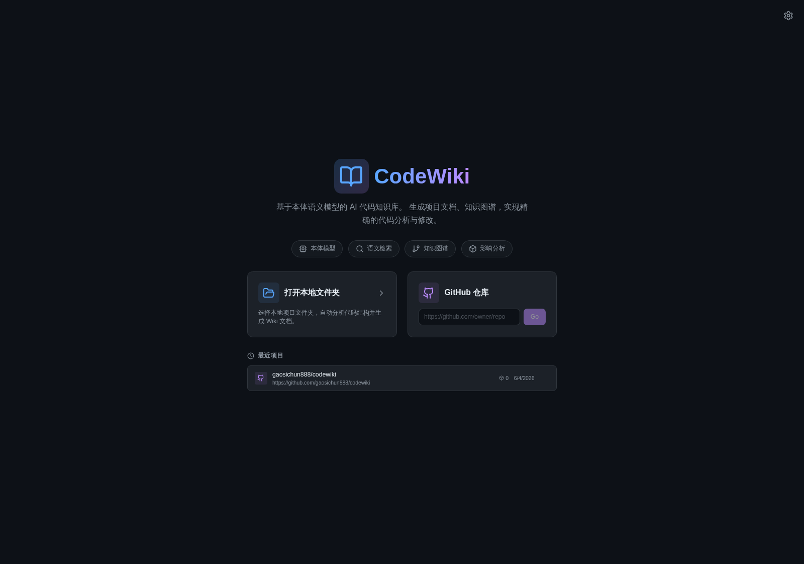
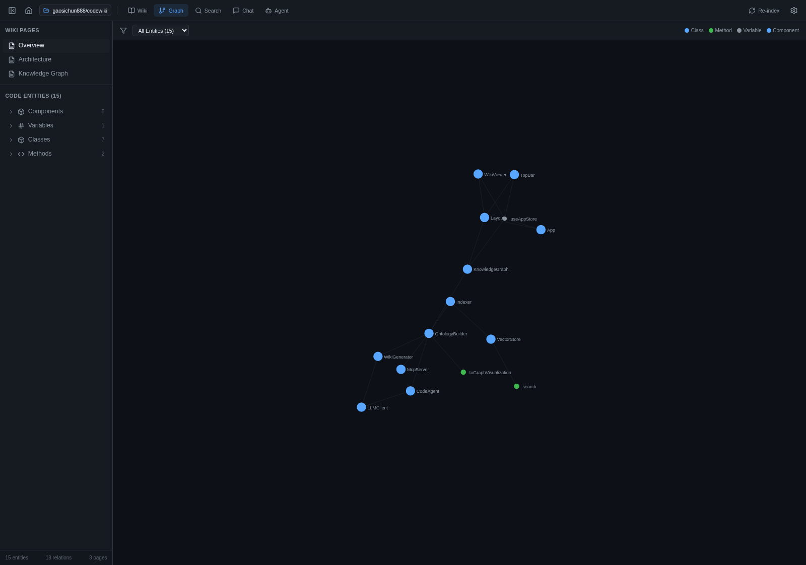
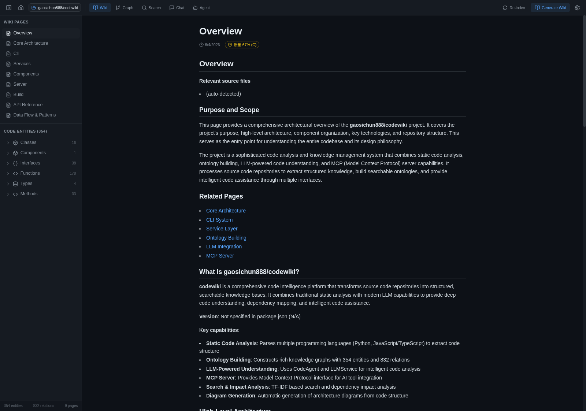
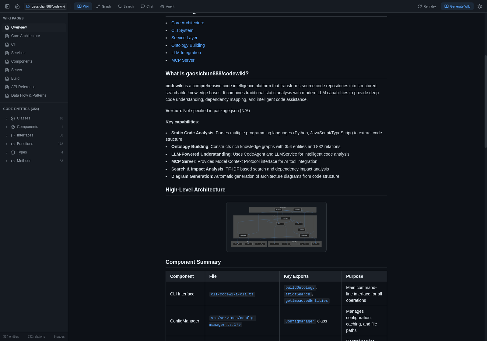
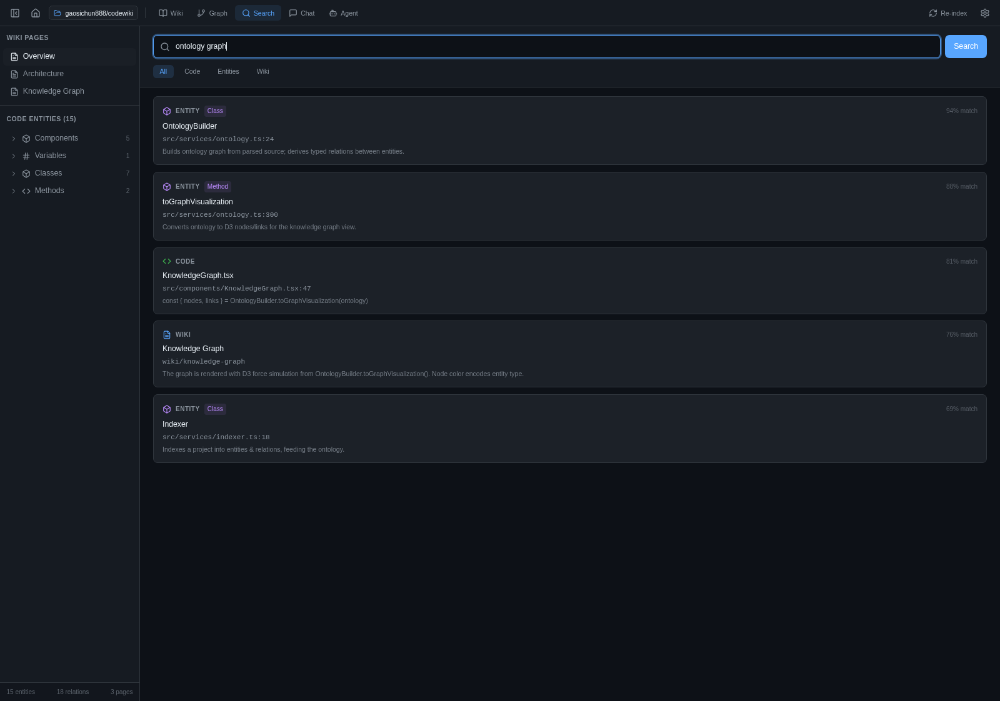
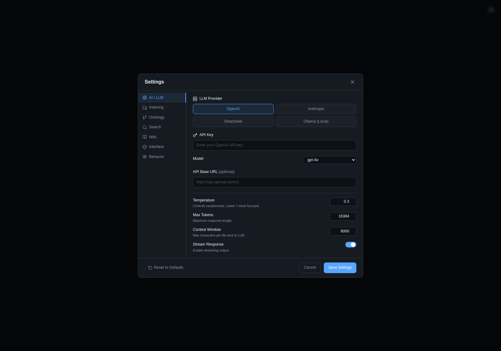

<div align="center">

# CodeWiki



### AI 代码知识库 —— 基于本体（Ontology）语义模型，真正“读懂”你的代码库

一款跨平台桌面应用（Windows / macOS / Linux），把任意本地文件夹或 GitHub 仓库
转化为：可阅读的 Wiki、可交互的知识图谱、语义搜索、RAG 智能问答，以及一个
**具备影响分析能力的精准代码 Agent** —— 全部由代码的**本体模型**驱动。

[English](README.md) · **简体中文**


</div>

<!-- codewiki-health-card:start -->

### Code Health

-red)    

> 962 entities · 3117 relations · 73 files · avg degree 2.51 · 44 pattern-tagged entities

<sub>Generated by `codewiki report` on 2026-06-06T12:30:34.662Z.</sub>

<!-- codewiki-health-card:end -->

---

## 关于（About）

大型代码库本就难以理解，安全地修改它更难。大多数“AI 写代码”工具把源码当成纯文本，
于是经常出现答非所问、甚至改坏依赖的情况。

**CodeWiki 不一样。** 它先把项目解析成一张带类型的**本体图谱（Ontology）**——
由*实体*（包、文件、类、接口、函数、方法、组件、类型）和它们之间的*关系*
（`contains`、`imports`、`extends`、`implements`、`calls`、`uses`、`dependsOn` 等）组成。
之后的每一个功能都建立在这张图谱之上：

- 📖 **Wiki**：基于真实结构生成文档，而非凭空臆测。
- 🕸️ **知识图谱**：让你“看见”代码是如何组织在一起的。
- 🔎 **语义搜索**：按语义对代码、实体与文档排序检索。
- 💬 **智能问答（RAG）**：回答附带 `文件:行号` 引用，全部基于本体。
- 🤖 **代码 Agent**：在提出修改前先在图谱上做影响分析，让改动精准、且感知跨文件依赖。

它**完全在本地运行**：内置 TF‑IDF 语义搜索无需任何外部服务；LLM 可自带 Key
（OpenAI / Anthropic / DeepSeek），也可用 **Ollama** 完全离线运行。CodeWiki 还自带
**MCP（Model Context Protocol）服务器**，让 Cursor、Claude 等编辑器查询同一份知识库，
并提供配套的 **VSCode 扩展**。

## 界面截图

| 知识图谱 | AI 生成的 Wiki（DeepSeek 真实生成） |
| --- | --- |
|  |  |

| AI 架构图 + 组件表 | 语义搜索 |
| --- | --- |
|  |  |

| LLM 设置 | |
| --- | --- |
|  | |

> 上面「AI 生成的 Wiki」截图是 CodeWiki 直接索引本仓库（354 entities / 832 relations）后，
> 用 **DeepSeek** 实时生成的文档——包括 Mermaid 架构图，以及带真实 `文件:行号` 引用的组件表。

## 功能特性

### 核心 Wiki 引擎
- **一键生成 Wiki**：选择本地文件夹或填入 GitHub 仓库地址 → AI 生成完整 Wiki 文档
- **Mermaid 图表**：自动生成架构图与数据流图
- **Wiki 导航**：侧边栏页面树、行内源码引用、每页文档质量校验

### 基于本体的语义模型
- **代码本体**：类 RDF 的代码实体知识图谱（类、函数、接口、模块等）
- **关系抽取**：自动识别 imports / extends / implements / calls / contains 等关系
- **影响分析**：查询本体，找出某处改动会影响到的所有实体
- **类型感知检索**：用本体关系增强语义搜索

### 知识图谱可视化
- **2D & 3D 双模式**：经典 D3 力导向图，或 GitNexus 风格的 **3D** 力导向图（three.js / `3d-force-graph`）——在「设置 → 图谱」中切换
- **按类型筛选**：Class、Function、Interface、Component 等
- **轨道旋转 / 拖拽 & 缩放**：旋转、缩放、平移，以可视化方式浏览大型代码库
- **颜色编码**：不同实体类型采用不同颜色，可选标签与自动旋转

### 语义搜索
- **TF‑IDF 向量库**：本地语义搜索，无需外部 API
- **本体感知**：检索结果带实体关系信息
- **多类型检索**：同时搜索 Wiki、代码与实体

### RAG 智能问答（Ask）
- **基于上下文的回答**：结合代码本体上下文的检索增强生成
- **来源引用**：每个回答都链接到具体的 `文件:行号`
- **流式输出**：兼容 OpenAI 的 Provider 支持实时流式响应

### 代码 Agent
- **受本体约束的修改**：改动前用知识图谱做影响分析
- **精准修改**：明确的文件路径、行号与 diff
- **抗幻觉**：所有改动都对照真实代码结构校验
- **跨文件感知**：理解跨文件依赖

### MCP（Model Context Protocol）服务器
- **29 个 MCP 工具**：代码搜索、本体查询、调用图遍历、影响/爆炸半径分析、架构概览、死代码检测、重建索引等 —— 完整列表见 [docs/MCP.zh-CN.md](docs/MCP.zh-CN.md)
- **IDE 集成**：任何兼容 MCP 的 IDE 或 Agent（Claude Desktop、Cursor、VS Code、Windsurf、Cline……）都能查询该代码知识库
- **Stdio 协议**：标准 MCP 服务器，通过 stdio 通信
- **配置指南**：[docs/MCP.zh-CN.md](docs/MCP.zh-CN.md)（[English](docs/MCP.md)）

### VSCode 扩展
- **侧边栏视图**：Wiki 页面、代码实体、聊天面板
- **命令**：打开 Wiki、语义搜索、知识图谱、提问、生成 Wiki、影响分析
- **MCP 客户端**：与 CodeWiki 桌面应用通信

## 技术栈

- **桌面端**：Electron + React 18 + TypeScript + Vite
- **样式**：TailwindCSS（深色主题）
- **LLM**：OpenAI / Anthropic / DeepSeek / Ollama（本地）
- **本体**：自研类 RDF 的实体-关系模型
- **向量库**：本地 TF‑IDF 向量库
- **图表**：Mermaid.js
- **图谱**：D3-force
- **状态管理**：Zustand
- **MCP**：`@modelcontextprotocol/sdk`
- **VSCode**：VSCode Extension API

## 一键安装

需要 Node.js 18+ 与 git。脚本会自动 clone、构建并打包成你当前平台的安装包。
详见 [INSTALL.md](INSTALL.md)（含预编译安装包下载）。

```bash
# macOS / Linux
curl -fsSL https://raw.githubusercontent.com/gaosichun888/codewiki/main/install.sh | bash
```

```powershell
# Windows (PowerShell)
irm https://raw.githubusercontent.com/gaosichun888/codewiki/main/install.ps1 | iex
```

预编译安装包（`.AppImage`、`.deb`、Windows `.exe`、macOS `.dmg`）发布在
[GitHub Releases](https://github.com/gaosichun888/codewiki/releases)。

## 下载（最新：v1.0.2）

从 [v1.0.2 发布页](https://github.com/gaosichun888/codewiki/releases/tag/v1.0.2) 选择你平台的预编译安装包：

| 平台 | 下载 |
|---|---|
| Windows（安装版） | [`CodeWiki.Setup.1.0.2.exe`](https://github.com/gaosichun888/codewiki/releases/download/v1.0.2/CodeWiki.Setup.1.0.2.exe) |
| Windows（便携版） | [`CodeWiki.1.0.2.exe`](https://github.com/gaosichun888/codewiki/releases/download/v1.0.2/CodeWiki.1.0.2.exe) |
| macOS（Apple Silicon） | [`CodeWiki-1.0.2-arm64.dmg`](https://github.com/gaosichun888/codewiki/releases/download/v1.0.2/CodeWiki-1.0.2-arm64.dmg) |
| macOS（Intel） | [`CodeWiki-1.0.2.dmg`](https://github.com/gaosichun888/codewiki/releases/download/v1.0.2/CodeWiki-1.0.2.dmg) |
| Linux（AppImage） | [`CodeWiki-1.0.2.AppImage`](https://github.com/gaosichun888/codewiki/releases/download/v1.0.2/CodeWiki-1.0.2.AppImage) |
| Linux（Debian/Ubuntu） | [`codewiki_1.0.2_amd64.deb`](https://github.com/gaosichun888/codewiki/releases/download/v1.0.2/codewiki_1.0.2_amd64.deb) |
| VSCode 扩展 | [`codewiki-vscode-0.2.0.vsix`](https://github.com/gaosichun888/codewiki/releases/download/v1.0.2/codewiki-vscode-0.2.0.vsix) |

> macOS 为未签名构建：首次打开请右键 → 打开，或在「系统设置 → 隐私与安全性」中放行。
> VSCode 扩展安装：`code --install-extension codewiki-vscode-0.2.0.vsix`。

## 从源码运行

```bash
# 安装依赖
npm install

# 开发模式
npm run electron:dev

# 生产构建
npm run electron:build
```

## 配置

1. 打开应用 → 点击 **设置**（齿轮图标）
2. 选择 LLM Provider（OpenAI、Anthropic、DeepSeek、Ollama）
3. 填入 API Key（使用 Ollama 时无需填写）
4. 选择模型

## MCP 服务器配置

先构建服务器，再让 MCP 客户端指向编译产物：

```bash
npm install
npm run build:mcp   # -> dist/server/mcp-server.js
```

```json
{
  "mcpServers": {
    "codewiki": {
      "command": "node",
      "args": ["/abs/path/to/codewiki/dist/server/mcp-server.js"],
      "env": { "PROJECT_PATH": "/abs/path/to/your/project" }
    }
  }
}
```

请使用**绝对路径**。`PROJECT_PATH` 是服务器要索引的项目；可选的
`CODEWIKI_LOG_DIR`（默认 `~/.codewiki`）设置调用日志的写入位置。

Claude Desktop、Cursor、VS Code、Windsurf 等的完整配置、全部工具说明与排错，详见
**[docs/MCP.zh-CN.md](docs/MCP.zh-CN.md)**（English: **[docs/MCP.md](docs/MCP.md)**）。

## 项目结构

```
codewiki/
├── electron/           # Electron 主进程
│   ├── main.ts        # 窗口管理、IPC、文件系统
│   └── preload.ts     # Context bridge API
├── src/               # React 渲染层
│   ├── components/    # UI 组件（Welcome、Layout、TopBar、Sidebar、
│   │                  #   WikiViewer、KnowledgeGraph、SearchPanel、ChatPanel、
│   │                  #   CodeAgentPanel、SettingsModal、MermaidDiagram）
│   ├── services/      # ontology、indexer、vector-store、llm、
│   │                  #   wiki-generator、code-agent、mcp-server
│   ├── store/         # Zustand 状态管理
│   └── types/         # TypeScript 类型定义
├── server/            # 独立 MCP 服务器
├── vscode-extension/  # VSCode 扩展
└── package.json
```

## 许可证

[MIT](LICENSE)
