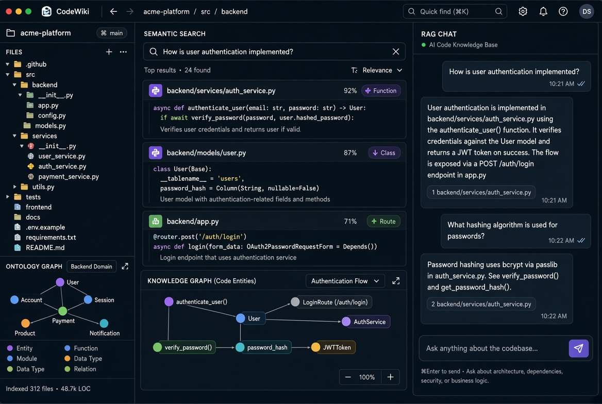

# CodeWiki 文档中心

AI Code Knowledge Base — 基于本体的代码知识库，支持知识图谱、语义搜索、RAG 对话与影响感知的代码代理（Electron，跨平台）。

## 界面预览

## 核心能力

- 代码本体建模与知识图谱
- 语义搜索与 RAG 问答
- 影响分析（Impact-aware）
- MCP 集成
- 跨平台桌面应用

## 文档

- [架构与核心概念](Architecture.md)
- [使用指南](User-Guide.md)
