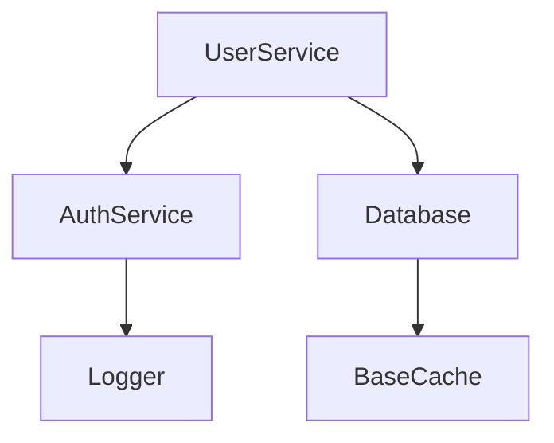

# Core Architecture

**Relevant source files**
- [services/user.ts](services/user.ts)
- [services/auth.ts](services/auth.ts)
- [services/database.ts](services/database.ts)
- [services/cache.ts](services/cache.ts)
- [services/logger.ts](services/logger.ts)

## Purpose and Scope

This page documents the core architecture of the sample TypeScript project,
covering the service layer (UserService, AuthService), the data layer
(Database), and cross-cutting concerns (Logger, BaseCache). It explains how
these components depend on each other and the design patterns used.

## Related Pages

- [Overview](1-overview.md)
- [API Reference](3-api-reference.md)
- [Data Flow & Patterns](4-data-flow-patterns.md)

## System Architecture

| Component | Module/File | Key Exports | Purpose |
|-----------|-------------|-------------|---------|
| UserService | services/user.ts | getUser, createUser | User domain logic |
| AuthService | services/auth.ts | validateToken | Authentication |
| Database | services/database.ts | findOne, query | Persistence layer |
| Logger | services/logger.ts | info, error | Structured logging |
| BaseCache | services/cache.ts | get, set | Generic TTL cache |

Sources: [services/user.ts#L1-L40](services/user.ts#L1-L40) [services/auth.ts#L1-L30](services/auth.ts#L1-L30)

## Design Patterns

The codebase uses the **Repository pattern** (Database abstracts persistence),
**Dependency Injection** (services receive collaborators via constructor), and
a **Generic Cache** (`BaseCache<T>`) for type-safe caching.

Sources: [services/database.ts#L10-L55](services/database.ts#L10-L55) [services/cache.ts#L5-L48](services/cache.ts#L5-L48)

## Key Architectural Decisions

- Service layer is kept thin and delegates persistence to `Database`.
- Logging is injected rather than imported globally to ease testing.

Sources: [services/user.ts#L1-L40](services/user.ts#L1-L40)
