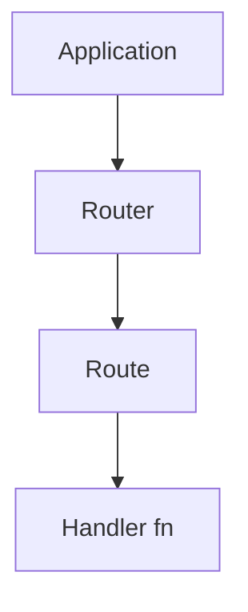

# Router and Route Architecture

**Relevant source files**
- [lib/application.js](lib/application.js)
- [lib/express.js](lib/express.js)
- [lib/request.js](lib/request.js)
- [lib/response.js](lib/response.js)
- [test/Router.js](test/Router.js)

## Purpose and Scope

This document describes the routing architecture, covering the three-tier
hierarchy of Application, Router, and Route objects, and how they dispatch
HTTP requests to handler functions.

## Related Pages

- [Middleware Execution Flow](4.1-middleware-execution-flow.md)
- [Path Matching and Parameters](3.2-path-matching-and-parameters.md)
- [Error Handling in Routes](3.3-error-handling-in-routes.md)

## Three-Tier Routing Hierarchy

Express uses a three-tier architecture for routing: Application -> Router -> Route.

| Tier | Component | Purpose |
|------|-----------|---------|
| 1 | Application | Top-level app with routing methods |
| 2 | Router | Mountable, modular route handlers |
| 3 | Route | Single path pattern + handler stack |

Sources: [lib/application.js#L69-L82](lib/application.js#L69-L82) [lib/express.js#L70-L71](lib/express.js#L70-L71)

## Router Class

The `Router` class manages a stack of layers and dispatches requests through them.

| Method | Purpose | Example |
|--------|---------|---------|
| `router.handle()` | Dispatch a request | Called internally |
| `router.use()` | Mount middleware | `router.use('/api', apiRouter)` |
| `router.route()` | Create a Route | `router.route('/users')` |

Sources: [test/Router.js#L1-L17](test/Router.js#L1-L17)
