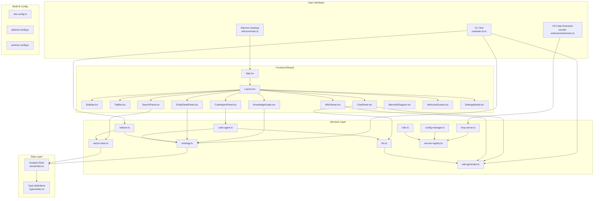

# CodeWiki Overview

**Relevant source files**

- [cli/codewiki-cli.ts](cli/codewiki-cli.ts)
- [dist-electron/main.js](dist-electron/main.js)
- [dist-electron/preload.js](dist-electron/preload.js)
- [electron/main.ts](electron/main.ts)
- [electron/preload.ts](electron/preload.ts)
- [postcss.config.js](postcss.config.js)
- [server/mcp-server.ts](server/mcp-server.ts)
- [src/App.tsx](src/App.tsx)
- [src/components/ChatPanel.tsx](src/components/ChatPanel.tsx)
- [src/components/CodeAgentPanel.tsx](src/components/CodeAgentPanel.tsx)
- [src/components/EntityDetailPanel.tsx](src/components/EntityDetailPanel.tsx)
- [src/components/KnowledgeGraph.tsx](src/components/KnowledgeGraph.tsx)

## Purpose and Scope

CodeWiki is a comprehensive code intelligence and documentation platform that automatically analyzes, indexes, and generates wiki-style documentation for software projects. It combines static analysis, ontology-based entity relationship mapping, vector search, and LLM-powered documentation generation to create an interactive knowledge base for any codebase.

The system supports both Python and TypeScript/JavaScript projects, providing:
- Automatic code indexing and ontology building
- Interactive knowledge graph visualization
- Full-text and semantic search across code entities
- LLM-powered wiki page generation
- MCP (Model Context Protocol) server integration for AI assistants
- CLI tool for batch operations
- Electron desktop application with React frontend

## Related Pages

- [Architecture Overview](architecture-overview.md)
- [CLI Tool Reference](cli-tool.md)
- [Service Layer](service-layer.md)
- [Frontend Components](frontend-components.md)
- [Ontology System](ontology-system.md)
- [Wiki Generation Pipeline](wiki-generation.md)
- [MCP Server Integration](mcp-server.md)

## High-Level Architecture



## Component Summary

| Component | File | Purpose |
|-----------|------|---------|
| **CLI Tool** | `cli/codewiki-cli.ts` | Command-line interface for indexing, analyzing, searching, and generating wiki documentation |
| **Electron Main** | `electron/main.ts` | Electron main process - window management, IPC, native integrations |
| **Electron Preload** | `electron/preload.ts` | Secure bridge between renderer and main process |
| **React App** | `src/App.tsx` | Root React component with routing and global state initialization |
| **Layout** | `src/components/Layout.tsx` | Main application shell with sidebar, topbar, and content area |
| **Sidebar** | `src/components/Sidebar.tsx` | Navigation sidebar with project tree and entity list |
| **TopBar** | `src/components/TopBar.tsx` | Top navigation bar with search, settings, and actions |
| **ChatPanel** | `src/components/ChatPanel.tsx` | AI chat interface for code questions and wiki generation |
| **KnowledgeGraph** | `src/components/KnowledgeGraph.tsx` | Interactive D3.js-based entity relationship visualization |
| **WikiViewer** | `src/components/WikiViewer.tsx` | Rendered wiki page display with Mermaid diagram support |
| **SearchPanel** | `src/components/SearchPanel.tsx` | Full-text and semantic search interface |
| **EntityDetailPanel** | `src/components/EntityDetailPanel.tsx` | Detailed view of code entities with relationships |
| **CodeAgentPanel** | `src/components/CodeAgentPanel.tsx` | Autonomous code analysis agent interface |
| **MermaidDiagram** | `src/components/MermaidDiagram.tsx` | Mermaid.js diagram renderer for wiki pages |
| **WelcomeScreen** | `src/components/WelcomeScreen.tsx` | First-run welcome and project setup wizard |
| **SettingsModal** | `src/components/SettingsModal.tsx` | Application configuration modal |
| **Indexer Service** | `src/services/indexer.ts` | Code file parsing, AST analysis, and entity extraction |
| **Ontology Service** | `src/services/ontology.ts` | Entity relationship graph construction and querying |
| **Vector Store** | `src/services/vector-store.ts` | Embedding-based semantic search storage and retrieval |
| **LLM Service** | `src/services/llm.ts` | LLM integration for code analysis and text generation |
| **Wiki Generator** | `src/services/wiki-generator.ts` | Template-based wiki page generation from ontology data |
| **MCP Server** | `src/services/mcp-server.ts` | Model Context Protocol server for AI assistant integration |
| **Config Manager** | `src/services/config-manager.ts` | Application configuration loading and validation |
| **i18n Service** | `src/services/i18n.ts` | Internationalization and localization support |
| **Service Registry** | `src/services/service-registry.ts` | Centralized service discovery and dependency injection |
| **Code Agent** | `src/services/code-agent.ts` | Autonomous agent for code analysis and refactoring suggestions |
| **State Store** | `src/store/index.ts` | Zustand-based global state management |
| **Type Definitions** | `src/types/index.ts` | Shared TypeScript interfaces and type definitions |
| **VS Code Extension** | `vscode-extension/src/extension.ts` | VS Code extension for inline code intelligence |

## Repository Structure

```
codewiki/
├── cli/
│   └── codewiki-cli.ts          # CLI entry point (818 lines)
├── dist-electron/               # Compiled Electron files
│   ├── main.js
│   └── preload.js
├── electron/
│   ├── main.ts                  # Electron main process
│   └── preload.ts               # Electron preload script
├── server/
│   └── mcp-server.ts            # MCP server implementation
├── src/
│   ├── App.tsx                  # Root React component
│   ├── main.tsx                 # React entry point
│   ├── components/
│   │   ├── ChatPanel.tsx        # AI chat interface
│   │   ├── CodeAgentPanel.tsx   # Code agent interface
│   │   ├── EntityDetailPanel.tsx# Entity details view
│   │   ├── KnowledgeGraph.tsx   # Entity relationship graph
│   │   ├── Layout.tsx           # Application layout
│   │   ├── MermaidDiagram.tsx   # Diagram renderer
│   │   ├── SearchPanel.tsx      # Search interface
│   │   ├── SettingsModal.tsx    # Settings dialog
│   │   ├── Sidebar.tsx          # Navigation sidebar
│   │   ├── TopBar.tsx           # Top navigation bar
│   │   ├── WelcomeScreen.tsx    # Welcome wizard
│   │   └── WikiViewer.tsx       # Wiki page viewer
│   ├── services/
│   │   ├── code-agent.ts        # Autonomous code agent
│   │   ├── config-manager.ts    # Configuration management
│   │   ├── i18n.ts              # Internationalization
│   │   ├── indexer.ts           # Code indexer
│   │   ├── llm.ts               # LLM integration
│   │   ├── mcp-server.ts        # MCP server service
│   │   ├── ontology.ts          # Ontology management
│   │   ├── service-registry.ts  # Service registry
│   │   ├── vector-store.ts      # Vector search store
│   │   ├── wiki-generator.ts    # Wiki page generator
│   │   └── wiki-prompt-templates.ts # LLM prompt templates
│   ├── store/
│   │   └── index.ts             # Zustand state store
│   └── types/
│       └── index.ts             # TypeScript type definitions
├── test-fixtures/
│   ├── py-project/              # Python test project
│   │   ├── api/
│   │   │   └── user_api.py
│   │   └── services/
│   │       ├── auth_service.py
│   │       ├── database.py
│   │       ├── logger.py
│   │       └── user_service.py
│   └── ts-project/              # TypeScript test project
│       ├── config.ts
│       ├── controllers/
│       │   └── user-controller.ts
│       ├── middleware/
│       │   └── auth-middleware.ts
│       └── services/
│           ├── auth.ts
│           ├── cache.ts
│           ├── database.ts
│           ├── logger.ts
│           └── user.ts
├── vscode-extension/
│   └── src/
│       └── extension.ts         # VS Code extension
├── vite.config.ts               # Vite build configuration
├── tailwind.config.js           # Tailwind CSS configuration
└── postcss.config.js            # PostCSS configuration
```

## Key Design Decisions

### 1. **Dual-Mode Architecture**
The system operates in two modes:
- **CLI Mode**: Batch processing for indexing, analysis, and wiki generation via `codewiki-cli.ts`
- **Desktop Mode**: Interactive Electron application with real-time updates and visualization

### 2. **Ontology-First Design**
The ontology system ([src/services/ontology.ts](src/services/ontology.ts)) serves as the central knowledge representation, extracting:
- **50 Files** with structural relationships
- **38 Classes** with inheritance hierarchies
- **72 Interfaces** with implementation chains
- **208 Functions** with call graphs
- **86 Methods** with class associations
- **8 Types** with usage patterns

### 3. **Multi-Layer Search**
- **TF-IDF Search**: Traditional text-based search ([cli/codewiki-cli.ts#L421](cli/codewiki-cli.ts#L421))
- **Vector Search**: Semantic embedding search ([src/services/vector-store.ts](src/services/vector-store.ts))
- **Graph Search**: Ontology-based relationship traversal ([src/services/ontology.ts](src/services/ontology.ts))

### 4. **LLM Integration**
The LLM service ([src/services/llm.ts](src/services/llm.ts)) powers:
- Wiki page generation from ontology data
- Code explanation and analysis
- Autonomous code agent actions
- Chat-based code queries

### 5. **MCP Protocol Support**
The MCP server ([server/mcp-server.ts](server/mcp-server.ts) and [src/services/mcp-server.ts](src/services/mcp-server.ts)) enables AI assistants to query the codebase through a standardized protocol.

## Sources:
- [cli/codewiki-cli.ts](cli/codewiki-cli.ts) - CLI implementation with ontology building, search, and wiki generation
- [electron/main.ts](electron/main.ts) - Electron main process
- [electron/preload.ts](electron/preload.ts) - Electron preload script
- [src/App.tsx](src/App.tsx) - Root React component
- [src/components/Layout.tsx](src/components/Layout.tsx) - Application layout
- [src/services/indexer.ts](src/services/indexer.ts) - Code indexing service
- [src/services/ontology.ts](src/services/ontology.ts) - Ontology management
- [src/services/vector-store.ts](src/services/vector-store.ts) - Vector search
- [src/services/llm.ts](src/services/llm.ts) - LLM integration
- [src/services/wiki-generator.ts](src/services/wiki-generator.ts) - Wiki generation
- [src/services/mcp-server.ts](src/services/mcp-server.ts) - MCP server service
- [src/services/service-registry.ts](src/services/service-registry.ts) - Service registry
- [src/store/index.ts](src/store/index.ts) - State management
- [src/types/index.ts](src/types/index.ts) - Type definitions
- [vscode-extension/src/extension.ts](vscode-extension/src/extension.ts) - VS Code extension
