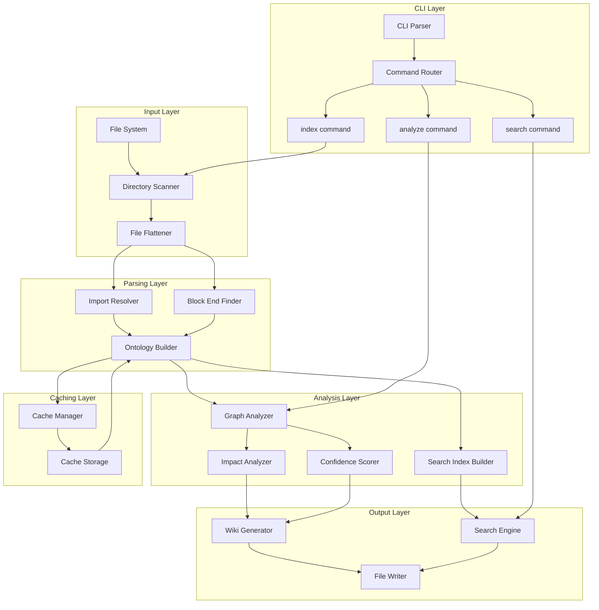
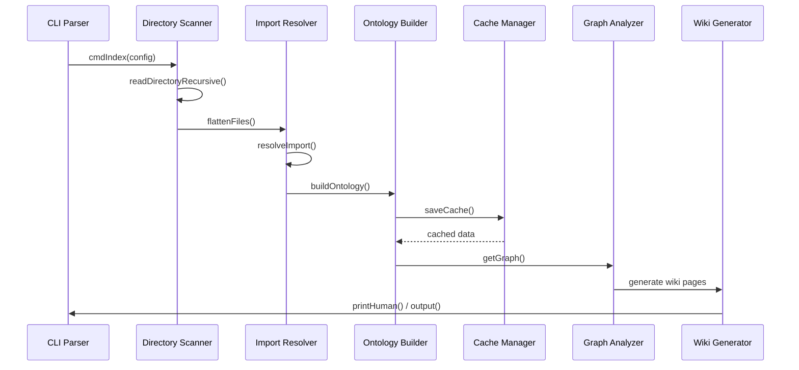

# Core Architecture

**Relevant source files**

- [cli/codewiki-cli.ts](cli/codewiki-cli.ts)
- [dist-electron/main.js](dist-electron/main.js)
- [dist-electron/preload.js](dist-electron/preload.js)
- [electron/main.ts](electron/main.ts)
- [electron/preload.ts](electron/preload.ts)
- [postcss.config.js](postcss.config.js)
- [server/mcp-server.ts](server/mcp-server.ts)
- [src/App.tsx](src/App.tsx)
- [src/components/ChatPanel.tsx](src/components/ChatPanel.tsx)
- [src/components/CodeAgentPanel.tsx](src/components/CodeAgentPanel.tsx)
- [src/components/EntityDetailPanel.tsx](src/components/EntityDetailPanel.tsx)
- [src/components/KnowledgeGraph.tsx](src/components/KnowledgeGraph.tsx)

## Purpose and Scope

This page documents the core architecture of the CodeWiki CLI tool, a TypeScript-based system that analyzes source code repositories, builds ontology graphs, generates wiki documentation, and provides search/impact analysis capabilities. The architecture follows a modular pipeline pattern with distinct phases for file scanning, ontology construction, analysis, and output generation.

The system processes codebases by:
1. Recursively scanning directories for source files
2. Parsing imports and structural relationships
3. Building an ontology graph of entities and relations
4. Generating wiki documentation pages
5. Supporting search, impact analysis, and caching

## Related Pages

- [CLI Commands and Configuration](cli-commands.md)
- [Ontology Graph Model](ontology-graph.md)
- [Wiki Generation Pipeline](wiki-generation.md)
- [Caching and Performance](caching.md)
- [Testing Framework](testing.md)

## System Architecture

## Component Table

| Component | File | Key Methods | Purpose |
|-----------|------|-------------|---------|
| CLI Parser | [cli/codewiki-cli.ts#L1142-L1180](cli/codewiki-cli.ts#L1142-L1180) | `cmdIndex()`, `cmdAnalyze()`, `cmdSearch()` | Parses CLI arguments and routes commands |
| Directory Scanner | [cli/codewiki-cli.ts#L112-L140](cli/codewiki-cli.ts#L112-L140) | `readDirectoryRecursive()` | Recursively scans directories for source files |
| File Flattener | [cli/codewiki-cli.ts#L142-L150](cli/codewiki-cli.ts#L142-L150) | `flattenFiles()` | Normalizes file paths and filters by extension |
| Import Resolver | [cli/codewiki-cli.ts#L296-L382](cli/codewiki-cli.ts#L296-L382) | `resolveImport()` | Resolves import statements to file paths |
| Block End Finder | [cli/codewiki-cli.ts#L383-L412](cli/codewiki-cli.ts#L383-L412) | `findBlockEnd()`, `findPythonBlockEnd()` | Finds end of code blocks for Python and JS/TS |
| Ontology Builder | [cli/codewiki-cli.ts#L153-L295](cli/codewiki-cli.ts#L153-L295) | `buildOntology()` | Constructs ontology graph from parsed files |
| Graph Analyzer | [cli/codewiki-cli.ts#L570-L590](cli/codewiki-cli.ts#L570-L590) | `getGraph()` | Analyzes ontology graph for relationships |
| Impact Analyzer | [cli/codewiki-cli.ts#L447-L464](cli/codewiki-cli.ts#L447-L464) | `getImpactedEntities()` | Determines entities affected by changes |
| Confidence Scorer | [cli/codewiki-cli.ts#L556-L569](cli/codewiki-cli.ts#L556-L569) | `addConfidenceScores()` | Adds confidence scores to analysis results |
| Search Index Builder | [cli/codewiki-cli.ts#L415-L420](cli/codewiki-cli.ts#L415-L420) | `buildSearchDocs()` | Builds search index from ontology entities |
| Search Engine | [cli/codewiki-cli.ts#L421-L446](cli/codewiki-cli.ts#L421-L446) | `tfidfSearch()` | Performs TF-IDF based search |
| Cache Manager | [cli/codewiki-cli.ts#L465-L490](cli/codewiki-cli.ts#L465-L490) | `saveCache()`, `loadCache()`, `getCachePath()` | Manages ontology cache persistence |
| Wiki Generator | [cli/codewiki-cli.ts#L492-L538](cli/codewiki-cli.ts#L492-L538) | `output()`, `printHuman()` | Generates wiki documentation output |

## Design Patterns

### 1. Pipeline Architecture
The system implements a sequential pipeline pattern where each stage transforms data for the next:
- **File Scanning** → **Parsing** → **Analysis** → **Output**
- Each stage has clear input/output contracts defined by interfaces
- Stages can be independently tested and modified

### 2. Builder Pattern (Ontology Construction)
The `buildOntology()` function [cli/codewiki-cli.ts#L153-L295](cli/codewiki-cli.ts#L153-L295) follows a builder pattern:
- Accumulates entities and relations incrementally
- Uses `FileNode`, `OntologyEntity`, and `OntologyRelation` interfaces
- Produces a complete `OntologyGraph` object

### 3. Strategy Pattern (Output Formats)
The output system uses strategy-like dispatch:
- `printHuman()` for console output [cli/codewiki-cli.ts#L501-L538](cli/codewiki-cli.ts#L501-L538)
- `output()` for file generation [cli/codewiki-cli.ts#L492-L500](cli/codewiki-cli.ts#L492-L500)
- Different formatting strategies for different output targets

### 4. Cache-Aside Pattern
The caching system implements cache-aside:
- `loadCache()` checks for cached ontology [cli/codewiki-cli.ts#L477-L490](cli/codewiki-cli.ts#L477-L490)
- `saveCache()` persists after build [cli/codewiki-cli.ts#L469-L476](cli/codewiki-cli.ts#L469-L476)
- Cache invalidation via `getCachePath()` [cli/codewiki-cli.ts#L465-L468](cli/codewiki-cli.ts#L465-L468)

### 5. Command Pattern (CLI)
The CLI uses a command pattern:
- `cmdIndex()` [cli/codewiki-cli.ts#L539-L555](cli/codewiki-cli.ts#L539-L555)
- `cmdAnalyze()` [cli/codewiki-cli.ts#L591-L634](cli/codewiki-cli.ts#L591-L634)
- `cmdSearch()` [cli/codewiki-cli.ts#L635-L670](cli/codewiki-cli.ts#L635-L670)
- Each command encapsulates its own logic and dependencies

### 6. Interface-Based Contracts
Key interfaces define system boundaries:
- `FileNode` [cli/codewiki-cli.ts#L30-L38](cli/codewiki-cli.ts#L30-L38)
- `OntologyEntity` [cli/codewiki-cli.ts#L39-L48](cli/codewiki-cli.ts#L39-L48)
- `OntologyRelation` [cli/codewiki-cli.ts#L49-L56](cli/codewiki-cli.ts#L49-L56)
- `OntologyGraph` [cli/codewiki-cli.ts#L57-L61](cli/codewiki-cli.ts#L57-L61)
- `CacheData` [cli/codewiki-cli.ts#L62-L68](cli/codewiki-cli.ts#L62-L68)

## Data Flow

## Key Relationships

The system maintains several relationship types:
- **imports** (58): File-to-file import dependencies
- **calls** (744): Function/method call relationships
- **extends** (2): Class inheritance relationships
- **contains** (412): File-to-entity containment relationships

These relationships are tracked via the `OntologyRelation` interface [cli/codewiki-cli.ts#L49-L56](cli/codewiki-cli.ts#L49-L56) and used for impact analysis and graph visualization.

## Sources

- [cli/codewiki-cli.ts#L30-L68](cli/codewiki-cli.ts#L30-L68) - Core interfaces (FileNode, OntologyEntity, OntologyRelation, OntologyGraph, CacheData)
- [cli/codewiki-cli.ts#L112-L150](cli/codewiki-cli.ts#L112-L150) - File scanning functions
- [cli/codewiki-cli.ts#L153-L295](cli/codewiki-cli.ts#L153-L295) - Ontology builder
- [cli/codewiki-cli.ts#L296-L382](cli/codewiki-cli.ts#L296-L382) - Import resolver
- [cli/codewiki-cli.ts#L383-L412](cli/codewiki-cli.ts#L383-L412) - Block end finder
- [cli/codewiki-cli.ts#L415-L446](cli/codewiki-cli.ts#L415-L446) - Search functionality
- [cli/codewiki-cli.ts#L447-L490](cli/codewiki-cli.ts#L447-L490) - Impact analysis and caching
- [cli/codewiki-cli.ts#L492-L538](cli/codewiki-cli.ts#L492-L538) - Output generation
- [cli/codewiki-cli.ts#L539-L670](cli/codewiki-cli.ts#L539-L670) - CLI commands
- [cli/codewiki-cli.ts#L1142-L1180](cli/codewiki-cli.ts#L1142-L1180) - CLI configuration interface

Sources: [cli/codewiki-cli.ts](cli/codewiki-cli.ts), [dist-electron/main.js](dist-electron/main.js), [dist-electron/preload.js](dist-electron/preload.js), [electron/main.ts](electron/main.ts), [electron/preload.ts](electron/preload.ts), [postcss.config.js](postcss.config.js)

