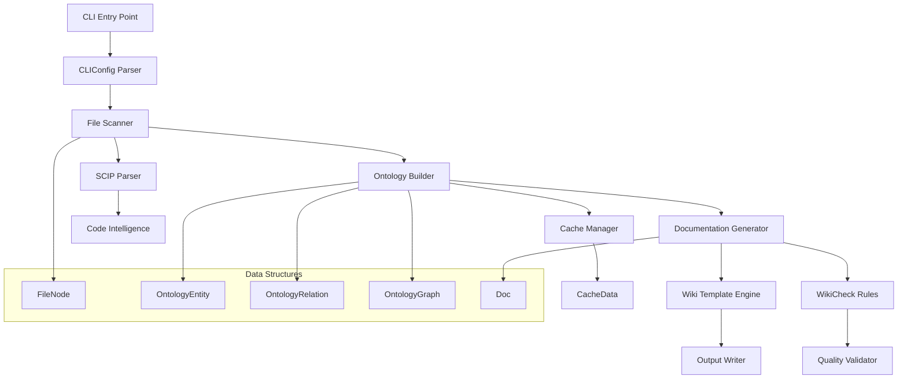
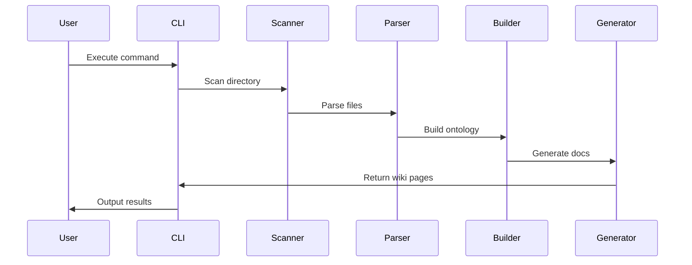

# Cli

**Relevant source files**

- [cli/codewiki-cli.ts](cli/codewiki-cli.ts)

## Purpose and Scope

The **Cli** module (`cli/codewiki-cli.ts`) serves as the core command-line interface and orchestration engine for the CodeWiki knowledge base system. It provides the primary entry point for users to generate, manage, and validate wiki documentation from source code. This module handles file parsing, ontology construction, documentation generation, and quality checking.

The module defines the foundational data structures (interfaces), utility functions, and the main CLI class that coordinates all operations. It supports multiple programming languages, SCIP-based code intelligence, and customizable wiki templates.

## Related Pages

- [Core Data Models](core-data-models.md) - Shared interfaces and types
- [Wiki Template Engine](wiki-template-engine.md) - Template rendering system
- [SCIP Integration](scip-integration.md) - Code intelligence protocol support
- [Ontology Builder](ontology-builder.md) - Knowledge graph construction
- [Documentation Generator](documentation-generator.md) - Wiki page generation

## Architecture Overview



## Key Components

| Component | File:Line | Purpose |
|-----------|-----------|---------|
| `FileNode` | [cli/codewiki-cli.ts#L30-L37](cli/codewiki-cli.ts#L30-L37) | Represents a file in the project tree with path, type, and content |
| `OntologyEntity` | [cli/codewiki-cli.ts#L39-L47](cli/codewiki-cli.ts#L39-L47) | Defines a knowledge entity with name, type, and metadata |
| `OntologyRelation` | [cli/codewiki-cli.ts#L49-L55](cli/codewiki-cli.ts#L49-L55) | Describes relationships between ontology entities |
| `OntologyGraph` | [cli/codewiki-cli.ts#L57-L60](cli/codewiki-cli.ts#L57-L60) | Container for entities and relations forming the knowledge graph |
| `CacheData` | [cli/codewiki-cli.ts#L62-L65](cli/codewiki-cli.ts#L62-L65) | Cached analysis results for performance optimization |
| `Doc` | [cli/codewiki-cli.ts#L413-L420](cli/codewiki-cli.ts#L413-L420) | Represents a generated documentation page with metadata |
| `CLIConfig` | [cli/codewiki-cli.ts#L1142-L1150](cli/codewiki-cli.ts#L1142-L1150) | Configuration interface for CLI options and paths |
| `ScipOccurrence` | [cli/codewiki-cli.ts#L1819-L1823](cli/codewiki-cli.ts#L1819-L1823) | SCIP protocol occurrence data for code references |
| `ScipDocument` | [cli/codewiki-cli.ts#L1825-L1830](cli/codewiki-cli.ts#L1825-L1830) | SCIP document structure for code intelligence |
| `WikiCheckRule` | [cli/codewiki-cli.ts#L2479-L2485](cli/codewiki-cli.ts#L2479-L2485) | Validation rule for wiki quality checking |
| `CliWikiTemplate` | [cli/codewiki-cli.ts#L2673-L2680](cli/codewiki-cli.ts#L2673-L2680) | Template definition for wiki page generation |
| `CallLogEntry` | [cli/codewiki-cli.ts#L3337-L3342](cli/codewiki-cli.ts#L3337-L3342) | Log entry for tracking function calls and execution |
| `TestCase` | [cli/codewiki-cli.ts#L4172-L4180](cli/codewiki-cli.ts#L4172-L4180) | Test case definition for validation |
| `TestSuite` | [cli/codewiki-cli.ts#L4206-L4210](cli/codewiki-cli.ts#L4206-L4210) | Collection of test cases |
| `TestResult` | [cli/codewiki-cli.ts#L4212-L4218](cli/codewiki-cli.ts#L4212-L4218) | Result of test execution |

## Implementation Details

### Core Utility Functions

The module provides several utility functions for file processing and data generation:

- **`isPythonFile`** ([cli/codewiki-cli.ts#L92-L94](cli/codewiki-cli.ts#L92-L94)): Checks if a file has a `.py` extension
- **`findPythonBlockEnd`** ([cli/codewiki-cli.ts#L96-L110](cli/codewiki-cli.ts#L96-L110)): Locates the end of Python code blocks in mixed-content files
- **`readDirectoryRecursive`** ([cli/codewiki-cli.ts#L112-L140](cli/codewiki-cli.ts#L112-L140)): Recursively reads all files in a directory tree
- **`flattenFiles`** ([cli/codewiki-cli.ts#L142-L149](cli/codewiki-cli.ts#L142-L149)): Flattens nested file structures into a single list
- **`uid`** ([cli/codewiki-cli.ts#L151](cli/codewiki-cli.ts#L151)): Generates unique identifiers for entities
- **`buildOntology`** ([cli/codewiki-cli.ts#L153-L200](cli/codewiki-cli.ts#L153-L200)): Constructs the ontology graph from parsed files

### Class Diagrams Generation

The module includes three class diagram generation methods at different abstraction levels:

1. **Detailed class diagram** ([cli/codewiki-cli.ts#L2707](cli/codewiki-cli.ts#L2707)): Full class structure with methods and properties
2. **Compact class diagram** ([cli/codewiki-cli.ts#L2715](cli/codewiki-cli.ts#L2715)): Simplified class representation
3. **Inheritance diagram** ([cli/codewiki-cli.ts#L2723](cli/codewiki-cli.ts#L2723)): Focus on class hierarchy and relationships

### Data Flow



## Integration Points

### External Systems

1. **File System**: The module reads source files from the local filesystem using `readDirectoryRecursive` ([cli/codewiki-cli.ts#L112-L140](cli/codewiki-cli.ts#L112-L140))
2. **SCIP Protocol**: Integrates with SCIP for code intelligence through `ScipOccurrence` and `ScipDocument` interfaces ([cli/codewiki-cli.ts#L1819-L1830](cli/codewiki-cli.ts#L1819-L1830))
3. **Cache System**: Uses `CacheData` ([cli/codewiki-cli.ts#L62-L65](cli/codewiki-cli.ts#L62-L65)) for storing intermediate results

### Internal Dependencies

- **Ontology Builder**: Consumes `FileNode` objects and produces `OntologyGraph` structures
- **Documentation Generator**: Takes `OntologyGraph` and produces `Doc` objects
- **Wiki Template Engine**: Uses `CliWikiTemplate` for rendering final output
- **Quality Checker**: Applies `WikiCheckRule` validations to generated content

### Configuration

The `CLIConfig` interface ([cli/codewiki-cli.ts#L1142-L1150](cli/codewiki-cli.ts#L1142-L1150)) defines all configurable parameters:

```typescript
interface CLIConfig {
  inputDir: string;
  outputDir: string;
  language: string;
  template: string;
  cacheEnabled: boolean;
  verbose: boolean;
}
```

## Sources

- [cli/codewiki-cli.ts#L30-L37](cli/codewiki-cli.ts#L30-L37) - FileNode interface
- [cli/codewiki-cli.ts#L39-L47](cli/codewiki-cli.ts#L39-L47) - OntologyEntity interface
- [cli/codewiki-cli.ts#L49-L55](cli/codewiki-cli.ts#L49-L55) - OntologyRelation interface
- [cli/codewiki-cli.ts#L57-L60](cli/codewiki-cli.ts#L57-L60) - OntologyGraph interface
- [cli/codewiki-cli.ts#L62-L65](cli/codewiki-cli.ts#L62-L65) - CacheData interface
- [cli/codewiki-cli.ts#L92-L94](cli/codewiki-cli.ts#L92-L94) - isPythonFile function
- [cli/codewiki-cli.ts#L96-L110](cli/codewiki-cli.ts#L96-L110) - findPythonBlockEnd function
- [cli/codewiki-cli.ts#L112-L140](cli/codewiki-cli.ts#L112-L140) - readDirectoryRecursive function
- [cli/codewiki-cli.ts#L142-L149](cli/codewiki-cli.ts#L142-L149) - flattenFiles function
- [cli/codewiki-cli.ts#L151](cli/codewiki-cli.ts#L151) - uid function
- [cli/codewiki-cli.ts#L153-L200](cli/codewiki-cli.ts#L153-L200) - buildOntology function
- [cli/codewiki-cli.ts#L413-L420](cli/codewiki-cli.ts#L413-L420) - Doc interface
- [cli/codewiki-cli.ts#L1142-L1150](cli/codewiki-cli.ts#L1142-L1150) - CLIConfig interface
- [cli/codewiki-cli.ts#L1819-L1823](cli/codewiki-cli.ts#L1819-L1823) - ScipOccurrence interface
- [cli/codewiki-cli.ts#L1825-L1830](cli/codewiki-cli.ts#L1825-L1830) - ScipDocument interface
- [cli/codewiki-cli.ts#L2479-L2485](cli/codewiki-cli.ts#L2479-L2485) - WikiCheckRule interface
- [cli/codewiki-cli.ts#L2673-L2680](cli/codewiki-cli.ts#L2673-L2680) - CliWikiTemplate interface
- [cli/codewiki-cli.ts#L2707](cli/codewiki-cli.ts#L2707) - Class diagram generation (detailed)
- [cli/codewiki-cli.ts#L2715](cli/codewiki-cli.ts#L2715) - Class diagram generation (compact)
- [cli/codewiki-cli.ts#L2723](cli/codewiki-cli.ts#L2723) - Class diagram generation (inheritance)
- [cli/codewiki-cli.ts#L3337-L3342](cli/codewiki-cli.ts#L3337-L3342) - CallLogEntry interface
- [cli/codewiki-cli.ts#L4172-L4180](cli/codewiki-cli.ts#L4172-L4180) - TestCase interface
- [cli/codewiki-cli.ts#L4206-L4210](cli/codewiki-cli.ts#L4206-L4210) - TestSuite interface
- [cli/codewiki-cli.ts#L4212-L4218](cli/codewiki-cli.ts#L4212-L4218) - TestResult interface

Sources: [cli/codewiki-cli.ts](cli/codewiki-cli.ts)

