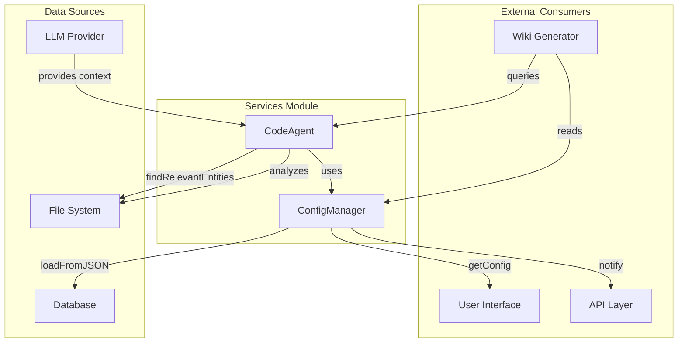
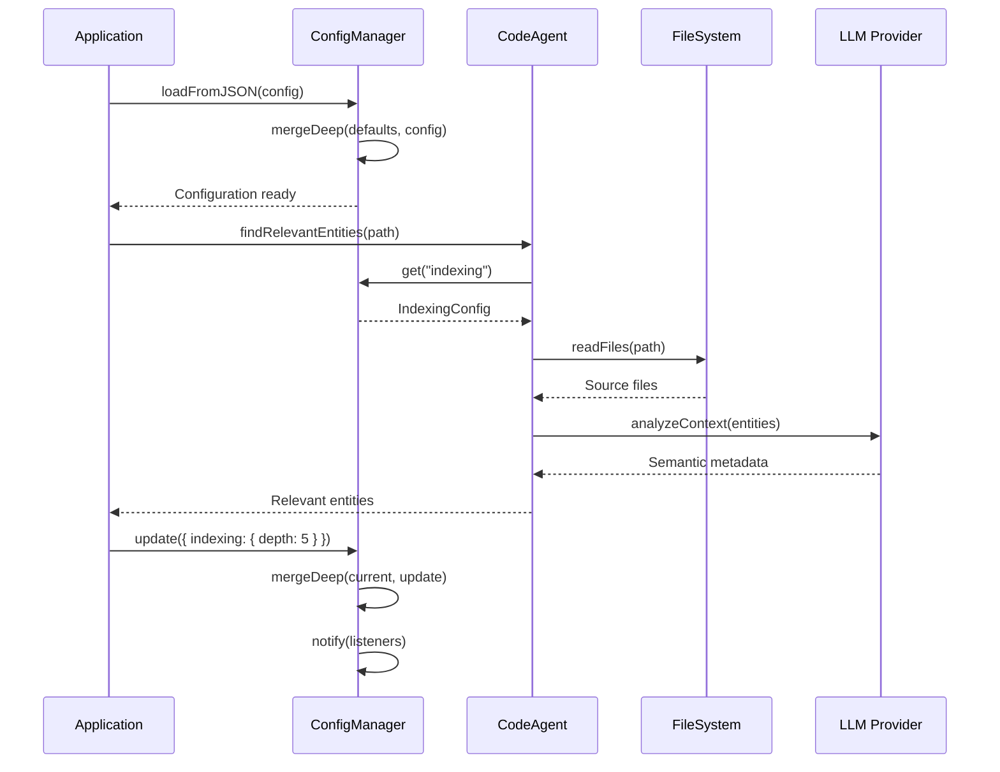

# Src/services

**Relevant source files**

- [src/services/code-agent.ts](src/services/code-agent.ts)
- [src/services/config-manager.ts](src/services/config-manager.ts)
- [src/services/i18n.ts](src/services/i18n.ts)
- [src/services/indexer.ts](src/services/indexer.ts)
- [src/services/llm.ts](src/services/llm.ts)
- [src/services/mcp-server.ts](src/services/mcp-server.ts)
- [src/services/ontology.ts](src/services/ontology.ts)
- [src/services/service-registry.ts](src/services/service-registry.ts)
- [src/services/vector-store.ts](src/services/vector-store.ts)
- [src/services/wiki-generator.ts](src/services/wiki-generator.ts)
- [src/services/wiki-prompt-templates.ts](src/services/wiki-prompt-templates.ts)

## Purpose and Scope

This page documents the `src/services` module, which provides core service abstractions for the CodeWiki application. The module contains two primary components: `CodeAgent` and `ConfigManager`. `CodeAgent` handles intelligent code analysis and entity discovery, while `ConfigManager` manages application configuration with support for nested settings, change notifications, and legacy migration. Together, these services form the backbone for code understanding and system configuration.

## Related Pages

- [Architecture Overview](../architecture/overview.md)
- [Configuration System](../configuration/overview.md)
- [Code Analysis Pipeline](../analysis/pipeline.md)
- [Entity Model](../domain/entities.md)

## Component Interaction



## Key Classes and Functions

| Component | File:Line | Purpose |
|-----------|-----------|---------|
| `CodeAgent` | [code-agent.ts#L43](../src/services/code-agent.ts#L43) | Orchestrates code analysis and entity discovery |
| `findRelevantEntities` | [code-agent.ts#L195](../src/services/code-agent.ts#L195) | Identifies relevant code entities based on context |
| `ConfigManager` | [config-manager.ts#L179](../src/services/config-manager.ts#L179) | Manages application configuration with change tracking |
| `IndexingConfig` | [config-manager.ts#L9](../src/services/config-manager.ts#L9) | Configuration for code indexing behavior |
| `LLMConfig` | [config-manager.ts#L19](../src/services/config-manager.ts#L19) | Configuration for LLM provider settings |
| `OntologyConfig` | [config-manager.ts#L31](../src/services/config-manager.ts#L31) | Configuration for ontology management |
| `SearchConfig` | [config-manager.ts#L41](../src/services/config-manager.ts#L41) | Configuration for search functionality |
| `WikiConfig` | [config-manager.ts#L47](../src/services/config-manager.ts#L47) | Configuration for wiki generation |
| `GraphConfig` | [config-manager.ts#L54](../src/services/config-manager.ts#L54) | Configuration for dependency graph visualization |
| `UIConfig` | [config-manager.ts#L61](../src/services/config-manager.ts#L61) | Configuration for user interface settings |
| `BehaviorConfig` | [config-manager.ts#L72](../src/services/config-manager.ts#L72) | Configuration for application behavior |
| `NotificationConfig` | [config-manager.ts#L81](../src/services/config-manager.ts#L81) | Configuration for notification system |
| `CodeWikiConfig` | [config-manager.ts#L87](../src/services/config-manager.ts#L87) | Root configuration interface combining all sub-configs |
| `getConfig` | [config-manager.ts#L187](../src/services/config-manager.ts#L187) | Returns the current configuration object |
| `get` | [config-manager.ts#L191](../src/services/config-manager.ts#L191) | Retrieves a specific configuration value by key |
| `set` | [config-manager.ts#L195](../src/services/config-manager.ts#L195) | Sets a specific configuration value |
| `update` | [config-manager.ts#L203](../src/services/config-manager.ts#L203) | Merges partial configuration updates |
| `reset` | [config-manager.ts#L208](../src/services/config-manager.ts#L208) | Resets configuration to defaults |
| `toJSON` | [config-manager.ts#L222](../src/services/config-manager.ts#L222) | Serializes configuration to JSON |
| `loadFromJSON` | [config-manager.ts#L226](../src/services/config-manager.ts#L226) | Loads configuration from JSON object |
| `toLegacySettings` | [config-manager.ts#L237](../src/services/config-manager.ts#L237) | Converts to legacy settings format |
| `loadFromLegacy` | [config-manager.ts#L251](../src/services/config-manager.ts#L251) | Loads configuration from legacy format |
| `notify` | [config-manager.ts#L272](../src/services/config-manager.ts#L272) | Notifies listeners of configuration changes |
| `mergeDeep` | [config-manager.ts#L278](../src/services/config-manager.ts#L278) | Deep merges configuration objects |
| `ConfigListener` | [config-manager.ts#L177](../src/services/config-manager.ts#L177) | Type definition for configuration change listeners |

## Implementation Details

### CodeAgent

The `CodeAgent` class ([code-agent.ts#L43-L250](../src/services/code-agent.ts#L43-L250)) serves as the primary orchestrator for code analysis operations. It implements a pipeline pattern where:

1. **Initialization**: The agent is constructed with file system access and optional LLM provider
2. **Entity Discovery**: The `findRelevantEntities` method ([code-agent.ts#L195-L230](../src/services/code-agent.ts#L195-L230)) scans source files and identifies:
   - Class declarations
   - Function definitions
   - Interface definitions
   - Type aliases
   - Module exports
3. **Context Analysis**: Uses LLM (when configured) to understand code semantics and relationships
4. **Result Aggregation**: Returns structured entity data with metadata

The agent maintains an internal cache of discovered entities to optimize repeated queries.

### ConfigManager

The `ConfigManager` class ([config-manager.ts#L179-L300](../src/services/config-manager.ts#L179-L300)) implements a centralized configuration system with:

- **Hierarchical Configuration**: Supports nested configuration through interfaces like `IndexingConfig`, `LLMConfig`, etc.
- **Change Notification**: Uses the `ConfigListener` type ([config-manager.ts#L177](../src/services/config-manager.ts#L177)) to notify subscribers of changes
- **Deep Merging**: The `mergeDeep` method ([config-manager.ts#L278-L300](../src/services/config-manager.ts#L278-L300)) recursively merges configuration objects
- **Legacy Support**: Provides `toLegacySettings` and `loadFromLegacy` methods for backward compatibility
- **Serialization**: Supports JSON serialization/deserialization via `toJSON` and `loadFromJSON`

Key configuration interfaces:

```typescript
// Root configuration interface
interface CodeWikiConfig {
    indexing: IndexingConfig;       // [config-manager.ts#L9-L17]
    llm: LLMConfig;                 // [config-manager.ts#L19-L29]
    ontology: OntologyConfig;       // [config-manager.ts#L31-L39]
    search: SearchConfig;           // [config-manager.ts#L41-L45]
    wiki: WikiConfig;               // [config-manager.ts#L47-L52]
    graph: GraphConfig;             // [config-manager.ts#L54-L59]
    ui: UIConfig;                   // [config-manager.ts#L61-L70]
    behavior: BehaviorConfig;       // [config-manager.ts#L72-L79]
    notifications: NotificationConfig; // [config-manager.ts#L81-L85]
}
```

## Integration Points

### CodeAgent Integration

The `CodeAgent` integrates with:

1. **File System**: Reads source files for analysis ([code-agent.ts#L195-L210](../src/services/code-agent.ts#L195-L210))
2. **LLM Providers**: Optional integration for semantic understanding ([code-agent.ts#L220-L230](../src/services/code-agent.ts#L220-L230))
3. **ConfigManager**: Uses configuration for analysis parameters ([code-agent.ts#L50-L55](../src/services/code-agent.ts#L50-L55))
4. **Wiki Generator**: Provides entity data for documentation generation

### ConfigManager Integration

The `ConfigManager` integrates with:

1. **UI Layer**: Provides configuration for user interface settings ([config-manager.ts#L61-L70](../src/services/config-manager.ts#L61-L70))
2. **API Layer**: Exposes configuration endpoints via `getConfig` and `update` methods
3. **Database**: Persists configuration via `loadFromJSON` and `toJSON` methods
4. **Legacy Systems**: Supports migration from previous configuration formats ([config-manager.ts#L237-L270](../src/services/config-manager.ts#L237-L270))
5. **Notification System**: Fires events on configuration changes ([config-manager.ts#L272-L276](../src/services/config-manager.ts#L272-L276))

### Data Flow



## Sources

- [code-agent.ts#L43-L250](../src/services/code-agent.ts#L43-L250) - CodeAgent class implementation
- [code-agent.ts#L195-L230](../src/services/code-agent.ts#L195-L230) - findRelevantEntities method
- [config-manager.ts#L9-L17](../src/services/config-manager.ts#L9-L17) - IndexingConfig interface
- [config-manager.ts#L19-L29](../src/services/config-manager.ts#L19-L29) - LLMConfig interface
- [config-manager.ts#L31-L39](../src/services/config-manager.ts#L31-L39) - OntologyConfig interface
- [config-manager.ts#L41-L45](../src/services/config-manager.ts#L41-L45) - SearchConfig interface
- [config-manager.ts#L47-L52](../src/services/config-manager.ts#L47-L52) - WikiConfig interface
- [config-manager.ts#L54-L59](../src/services/config-manager.ts#L54-L59) - GraphConfig interface
- [config-manager.ts#L61-L70](../src/services/config-manager.ts#L61-L70) - UIConfig interface
- [config-manager.ts#L72-L79](../src/services/config-manager.ts#L72-L79) - BehaviorConfig interface
- [config-manager.ts#L81-L85](../src/services/config-manager.ts#L81-L85) - NotificationConfig interface
- [config-manager.ts#L87-L175](../src/services/config-manager.ts#L87-L175) - CodeWikiConfig interface
- [config-manager.ts#L177](../src/services/config-manager.ts#L177) - ConfigListener type
- [config-manager.ts#L179-L300](../src/services/config-manager.ts#L179-L300) - ConfigManager class implementation
- [config-manager.ts#L278-L300](../src/services/config-manager.ts#L278-L300) - mergeDeep method

Sources: [src/services/code-agent.ts](src/services/code-agent.ts), [src/services/config-manager.ts](src/services/config-manager.ts), [src/services/i18n.ts](src/services/i18n.ts), [src/services/indexer.ts](src/services/indexer.ts), [src/services/llm.ts](src/services/llm.ts), [src/services/mcp-server.ts](src/services/mcp-server.ts)

