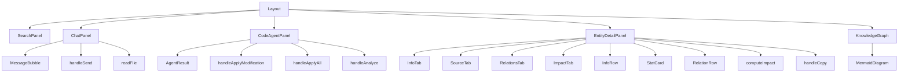

# Components

**Relevant source files**

- [src/components/ChatPanel.tsx](src/components/ChatPanel.tsx)
- [src/components/CodeAgentPanel.tsx](src/components/CodeAgentPanel.tsx)
- [src/components/EntityDetailPanel.tsx](src/components/EntityDetailPanel.tsx)
- [src/components/KnowledgeGraph.tsx](src/components/KnowledgeGraph.tsx)
- [src/components/Layout.tsx](src/components/Layout.tsx)
- [src/components/MermaidDiagram.tsx](src/components/MermaidDiagram.tsx)
- [src/components/SearchPanel.tsx](src/components/SearchPanel.tsx)
- [src/components/SettingsModal.tsx](src/components/SettingsModal.tsx)
- [src/components/Sidebar.tsx](src/components/Sidebar.tsx)
- [src/components/TopBar.tsx](src/components/TopBar.tsx)
- [src/components/WelcomeScreen.tsx](src/components/WelcomeScreen.tsx)
- [src/components/WikiViewer.tsx](src/components/WikiViewer.tsx)

## Purpose and Scope

This page documents the **Components** module of the code knowledge base application. The module contains all React UI components that form the user interface, including chat functionality, code agent interaction, entity detail visualization, knowledge graph rendering, search capabilities, and layout management. These components are the primary building blocks for the application's frontend, handling user input, data display, and interactive features.

The module is organized into six main component groups:
- **ChatPanel**: Messaging interface for user-agent communication
- **CodeAgentPanel**: Code analysis and modification panel
- **EntityDetailPanel**: Detailed view of code entities with tabs
- **KnowledgeGraph**: Interactive graph visualization
- **Layout**: Application shell and navigation
- **SearchPanel**: Search functionality
- **MermaidDiagram**: Diagram rendering utility

## Related Pages

- [Architecture Overview](./architecture.md)
- [State Management](./state-management.md)
- [API Integration](./api-integration.md)
- [Styling Guide](./styling-guide.md)

## Component Interaction Diagram

## Key Components and Functions

| Component/Function | File:Line | Purpose |
|-------------------|-----------|---------|
| ChatPanel | [src/components/ChatPanel.tsx#L11](../src/components/ChatPanel.tsx#L11) | Main chat interface component |
| MessageBubble | [src/components/ChatPanel.tsx#L184](../src/components/ChatPanel.tsx#L184) | Individual message display component |
| handleSend | [src/components/ChatPanel.tsx#L24](../src/components/ChatPanel.tsx#L24) | Handles sending chat messages |
| readFile | [src/components/ChatPanel.tsx#L42](../src/components/ChatPanel.tsx#L42) | File reading utility for chat |
| AgentResult | [src/components/CodeAgentPanel.tsx#L10](../src/components/CodeAgentPanel.tsx#L10) | Interface for agent operation results |
| CodeAgentPanel | [src/components/CodeAgentPanel.tsx#L17](../src/components/CodeAgentPanel.tsx#L17) | Code analysis and modification panel |
| handleApplyModification | [src/components/CodeAgentPanel.tsx#L26](../src/components/CodeAgentPanel.tsx#L26) | Applies single code modification |
| handleApplyAll | [src/components/CodeAgentPanel.tsx#L46](../src/components/CodeAgentPanel.tsx#L46) | Applies all pending modifications |
| handleAnalyze | [src/components/CodeAgentPanel.tsx#L55](../src/components/CodeAgentPanel.tsx#L55) | Triggers code analysis |
| EntityDetailPanel | [src/components/EntityDetailPanel.tsx#L38](../src/components/EntityDetailPanel.tsx#L38) | Detailed entity information panel |
| InfoTab | [src/components/EntityDetailPanel.tsx#L150](../src/components/EntityDetailPanel.tsx#L150) | General information tab |
| SourceTab | [src/components/EntityDetailPanel.tsx#L195](../src/components/EntityDetailPanel.tsx#L195) | Source code display tab |
| RelationsTab | [src/components/EntityDetailPanel.tsx#L248](../src/components/EntityDetailPanel.tsx#L248) | Entity relationships tab |
| ImpactTab | [src/components/EntityDetailPanel.tsx#L318](../src/components/EntityDetailPanel.tsx#L318) | Impact analysis tab |
| InfoRow | [src/components/EntityDetailPanel.tsx#L382](../src/components/EntityDetailPanel.tsx#L382) | Single info row component |
| StatCard | [src/components/EntityDetailPanel.tsx#L391](../src/components/EntityDetailPanel.tsx#L391) | Statistics display card |
| RelationRow | [src/components/EntityDetailPanel.tsx#L400](../src/components/EntityDetailPanel.tsx#L400) | Relationship row component |
| computeImpact | [src/components/EntityDetailPanel.tsx#L426](../src/components/EntityDetailPanel.tsx#L426) | Impact calculation utility |
| handleCopy | [src/components/EntityDetailPanel.tsx#L198](../src/components/EntityDetailPanel.tsx#L198) | Copy to clipboard handler |
| KnowledgeGraph | [src/components/KnowledgeGraph.tsx#L36](../src/components/KnowledgeGraph.tsx#L36) | Interactive knowledge graph component |
| Layout | [src/components/Layout.tsx#L11](../src/components/Layout.tsx#L11) | Application layout and navigation |
| Props | [src/components/MermaidDiagram.tsx#L23](../src/components/MermaidDiagram.tsx#L23) | Mermaid diagram component props interface |
| MermaidDiagram | [src/components/MermaidDiagram.tsx#L27](../src/components/MermaidDiagram.tsx#L27) | Mermaid diagram rendering component |
| render | [src/components/MermaidDiagram.tsx#L34](../src/components/MermaidDiagram.tsx#L34) | Diagram rendering logic |
| SearchPanel | [src/components/SearchPanel.tsx#L7](../src/components/SearchPanel.tsx#L7) | Search interface component |

## Implementation Details

### ChatPanel Component
The `ChatPanel` component ([src/components/ChatPanel.tsx#L11-L183](../src/components/ChatPanel.tsx#L11-L183)) implements a full-featured chat interface. It manages message state, handles user input, and renders message history using `MessageBubble` components. The `handleSend` function ([src/components/ChatPanel.tsx#L24-L41](../src/components/ChatPanel.tsx#L24-L41)) processes user messages and triggers appropriate responses. The `readFile` utility ([src/components/ChatPanel.tsx#L42-L60](../src/components/ChatPanel.tsx#L42-L60)) enables file attachment functionality.

### CodeAgentPanel Component
The `CodeAgentPanel` ([src/components/CodeAgentPanel.tsx#L17-L80](../src/components/CodeAgentPanel.tsx#L17-L80)) provides code analysis and modification capabilities. It uses the `AgentResult` interface ([src/components/CodeAgentPanel.tsx#L10-L15](../src/components/CodeAgentPanel.tsx#L10-L15)) to structure analysis results. Key handlers include:
- `handleApplyModification` ([src/components/CodeAgentPanel.tsx#L26-L45](../src/components/CodeAgentPanel.tsx#L26-L45)): Applies individual code changes
- `handleApplyAll` ([src/components/CodeAgentPanel.tsx#L46-L54](../src/components/CodeAgentPanel.tsx#L46-L54)): Batch applies all modifications
- `handleAnalyze` ([src/components/CodeAgentPanel.tsx#L55-L70](../src/components/CodeAgentPanel.tsx#L55-L70)): Initiates code analysis

### EntityDetailPanel Component
The `EntityDetailPanel` ([src/components/EntityDetailPanel.tsx#L38-L149](../src/components/EntityDetailPanel.tsx#L38-L149)) provides a tabbed interface for viewing entity details. It contains four main tabs:
- **InfoTab** ([src/components/EntityDetailPanel.tsx#L150-L194](../src/components/EntityDetailPanel.tsx#L150-L194)): Displays entity metadata using `InfoRow` components
- **SourceTab** ([src/components/EntityDetailPanel.tsx#L195-L247](../src/components/EntityDetailPanel.tsx#L195-L247)): Shows source code with syntax highlighting
- **RelationsTab** ([src/components/EntityDetailPanel.tsx#L248-L317](../src/components/EntityDetailPanel.tsx#L248-L317)): Lists entity relationships using `RelationRow` components
- **ImpactTab** ([src/components/EntityDetailPanel.tsx#L318-L381](../src/components/EntityDetailPanel.tsx#L318-L381)): Displays impact analysis using `StatCard` components

The `computeImpact` function ([src/components/EntityDetailPanel.tsx#L426-L450](../src/components/EntityDetailPanel.tsx#L426-L450)) calculates the impact score for entities.

### KnowledgeGraph Component
The `KnowledgeGraph` ([src/components/KnowledgeGraph.tsx#L36-L120](../src/components/KnowledgeGraph.tsx#L36-L120)) renders an interactive graph visualization. It integrates with `MermaidDiagram` for rendering and handles user interactions like node selection and zoom.

### Layout Component
The `Layout` ([src/components/Layout.tsx#L11-L50](../src/components/Layout.tsx#L11-L50)) provides the application shell with navigation, header, and content area. It manages the overall page structure and routing.

### MermaidDiagram Component
The `MermaidDiagram` ([src/components/MermaidDiagram.tsx#L27-L60](../src/components/MermaidDiagram.tsx#L27-L60)) renders Mermaid.js diagrams. It accepts a `Props` interface ([src/components/MermaidDiagram.tsx#L23-L26](../src/components/MermaidDiagram.tsx#L23-L26)) and implements the `render` function ([src/components/MermaidDiagram.tsx#L34-L55](../src/components/MermaidDiagram.tsx#L34-L55)) for diagram generation.

### SearchPanel Component
The `SearchPanel` ([src/components/SearchPanel.tsx#L7-L45](../src/components/SearchPanel.tsx#L7-L45)) provides search functionality with autocomplete and result filtering.

## Integration Points

The Components module integrates with the following systems:

1. **State Management**: Components consume global state through React Context or Redux store
2. **API Layer**: Components call API services for data fetching and mutations
3. **Routing**: Layout component integrates with React Router for navigation
4. **External Libraries**: MermaidDiagram integrates with Mermaid.js for diagram rendering
5. **Event System**: Components emit custom events for cross-component communication

**Sources:**
- [src/components/ChatPanel.tsx](../src/components/ChatPanel.tsx)
- [src/components/CodeAgentPanel.tsx](../src/components/CodeAgentPanel.tsx)
- [src/components/EntityDetailPanel.tsx](../src/components/EntityDetailPanel.tsx)
- [src/components/KnowledgeGraph.tsx](../src/components/KnowledgeGraph.tsx)
- [src/components/Layout.tsx](../src/components/Layout.tsx)
- [src/components/MermaidDiagram.tsx](../src/components/MermaidDiagram.tsx)
- [src/components/SearchPanel.tsx](../src/components/SearchPanel.tsx)
