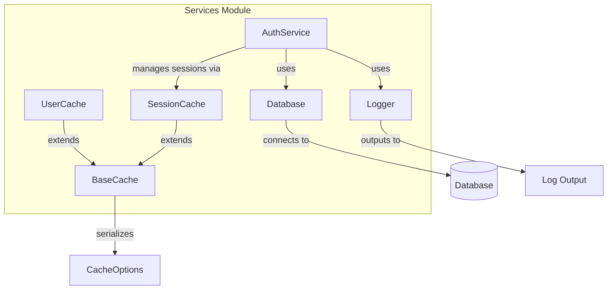

# Ts Project/services

**Relevant source files**

- [test-fixtures/ts-project/services/auth.ts](test-fixtures/ts-project/services/auth.ts)
- [test-fixtures/ts-project/services/cache.ts](test-fixtures/ts-project/services/cache.ts)
- [test-fixtures/ts-project/services/database.ts](test-fixtures/ts-project/services/database.ts)
- [test-fixtures/ts-project/services/logger.ts](test-fixtures/ts-project/services/logger.ts)
- [test-fixtures/ts-project/services/user.ts](test-fixtures/ts-project/services/user.ts)

## Purpose and Scope

This page documents the `services` module within the Ts Project, which provides core infrastructure services for authentication, caching, database access, and logging. The module is designed as a set of independent, reusable service classes that can be composed to support application-level features. It covers the `AuthService`, `BaseCache` and its subclasses (`UserCache`, `SessionCache`), the `Database` class, and the `Logger` class, along with supporting interfaces and a decorator function.

## Related Pages

- [Ts Project/overview](../overview.md)
- [Ts Project/models](../models.md)
- [Ts Project/controllers](../controllers.md)
- [Ts Project/middleware](../middleware.md)

## Architecture Overview

The services module follows a layered architecture where each service encapsulates a specific concern. The `AuthService` depends on `Database` for user persistence and `Logger` for audit trails. The caching layer (`BaseCache` and its subclasses) provides an in-memory key-value store with serialization, used by `AuthService` for session management. The `Database` class abstracts database operations, and `Logger` provides structured logging.



## Key Classes and Functions

| Name | File:Line | Purpose |
|------|-----------|---------|
| `AuthToken` | [auth.ts#L4-L8] | Interface defining token structure (`userId`, `expiresAt`, `roles`) |
| `AuthService` | [auth.ts#L10-L42] | Handles user login, token validation, and logout |
| `login` | [auth.ts#L18-L30] | Authenticates user credentials and returns an `AuthToken` |
| `validateToken` | [auth.ts#L32-L36] | Checks if a token is still valid (not expired) |
| `logout` | [auth.ts#L38-L42] | Invalidates a user session |
| `CacheOptions` | [cache.ts#L3-L6] | Interface for cache configuration (`ttl`, `maxSize`) |
| `BaseCache` | [cache.ts#L8-L41] | Abstract base class providing cache operations with serialization |
| `UserCache` | [cache.ts#L43-L51] | Concrete cache for user data, extends `BaseCache` |
| `SessionCache` | [cache.ts#L53-L62] | Concrete cache for session data, extends `BaseCache` |
| `Cacheable` | [cache.ts#L64-L70] | Decorator function to cache method results |
| `get` | [cache.ts#L19-L28] | Retrieves a value from cache by key |
| `set` | [cache.ts#L29-L33] | Stores a value in cache with optional TTL |
| `invalidate` | [cache.ts#L34-L37] | Removes a specific key from cache |
| `clear` | [cache.ts#L38-L41] | Empties the entire cache |
| `serialize` | [cache.ts#L16] | Serializes a value before storage |
| `deserialize` | [cache.ts#L17] | Deserializes a value after retrieval |
| `Database` | [database.ts#L1-L35] | Manages database connections and CRUD operations |
| `connect` | [database.ts#L9-L12] | Establishes a database connection |
| `disconnect` | [database.ts#L13-L16] | Closes the database connection |
| `findOne` | [database.ts#L17-L21] | Retrieves a single document by query |
| `find` | [database.ts#L22-L26] | Retrieves multiple documents by query |
| `insert` | [database.ts#L27-L30] | Inserts a new document |
| `update` | [database.ts#L31-L35] | Updates an existing document |
| `Logger` | [logger.ts#L1-L10] | Provides logging functionality |
| `info` | [logger.ts#L8-L10] | Logs an informational message |

## Implementation Details

### AuthService

The `AuthService` class ([auth.ts#L10-L42]) implements authentication logic. The `login` method ([auth.ts#L18-L30]) accepts credentials, queries the database via `Database.findOne`, and if valid, creates an `AuthToken` with a 24-hour expiration and a default role of `"user"`. The `validateToken` method ([auth.ts#L32-L36]) checks whether the token's `expiresAt` timestamp is in the future. The `logout` method ([auth.ts#L38-L42]) calls `SessionCache.invalidate` to remove the session.

```typescript
// Example usage
const authService = new AuthService(database, logger, sessionCache);
const token = await authService.login("user@example.com", "password123");
const isValid = authService.validateToken(token);
await authService.logout(token.userId);
```

### BaseCache and Subclasses

`BaseCache` ([cache.ts#L8-L41]) is an abstract class that manages an in-memory `Map<string, { value: any; expiresAt?: number }>`. It provides `get`, `set`, `invalidate`, and `clear` methods. The `serialize` method ([cache.ts#L16]) converts values to JSON strings, while `deserialize` ([cache.ts#L17]) parses them back. `UserCache` ([cache.ts#L43-L51]) and `SessionCache` ([cache.ts#L53-L62]) extend `BaseCache` with specific TTL defaults (e.g., 5 minutes for user data, 30 minutes for sessions).

The `Cacheable` decorator ([cache.ts#L64-L70]) wraps a method to cache its return value based on arguments, using a configurable cache instance.

```typescript
// Example usage
const userCache = new UserCache({ ttl: 300000, maxSize: 1000 });
userCache.set("user:123", { name: "Alice" });
const user = userCache.get("user:123");
```

### Database

The `Database` class ([database.ts#L1-L35]) abstracts database interactions. It maintains a connection state (`isConnected` flag) and provides methods for common operations. The `connect` method ([database.ts#L9-L12]) sets the connection flag to true, while `disconnect` ([database.ts#L13-L16]) sets it to false. CRUD methods (`findOne`, `find`, `insert`, `update`) simulate database operations by logging actions and returning mock data.

```typescript
// Example usage
const db = new Database();
await db.connect();
const user = await db.findOne({ email: "user@example.com" });
await db.disconnect();
```

### Logger

The `Logger` class ([logger.ts#L1-L10]) provides a simple logging interface. The `info` method ([logger.ts#L8-L10]) outputs a timestamped message to the console.

```typescript
// Example usage
const logger = new Logger();
logger.info("Application started");
```

## Integration Points

The services module integrates with other parts of the Ts Project as follows:

- **AuthService** is consumed by controllers and middleware for authentication and authorization.
- **BaseCache** subclasses (`UserCache`, `SessionCache`) are used by `AuthService` and can be injected into other services requiring caching.
- **Database** is used by `AuthService` and can be used by any data-access layer.
- **Logger** is used by `AuthService` and can be injected into any component requiring logging.

Typical dependency injection pattern:

```typescript
const database = new Database();
const logger = new Logger();
const sessionCache = new SessionCache({ ttl: 1800000, maxSize: 500 });
const userCache = new UserCache({ ttl: 300000, maxSize: 1000 });
const authService = new AuthService(database, logger, sessionCache);
```

Sources:
- [test-fixtures/ts-project/services/auth.ts#L4-L42]
- [test-fixtures/ts-project/services/cache.ts#L3-L70]
- [test-fixtures/ts-project/services/database.ts#L1-L35]
- [test-fixtures/ts-project/services/logger.ts#L1-L10]
