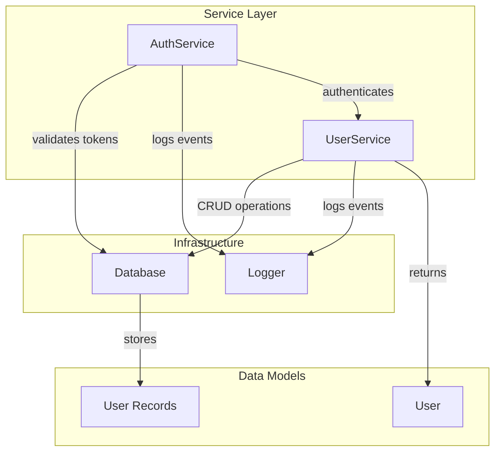

# Py Project/services

**Relevant source files**

- [test-fixtures/py-project/services/auth_service.py](test-fixtures/py-project/services/auth_service.py)
- [test-fixtures/py-project/services/database.py](test-fixtures/py-project/services/database.py)
- [test-fixtures/py-project/services/logger.py](test-fixtures/py-project/services/logger.py)
- [test-fixtures/py-project/services/user_service.py](test-fixtures/py-project/services/user_service.py)

## Purpose and Scope

This page documents the `services` module of the Py Project, which provides core business logic and infrastructure components for authentication, database access, logging, and user management. The module encapsulates reusable service classes that form the backbone of application operations, separating concerns between data access, authentication, logging, and user lifecycle management.

The services module includes:
- **AuthService**: Handles user authentication, token generation, and session management
- **Database**: Provides a mock database interface for CRUD operations
- **Logger**: Implements a simple logging utility with severity levels
- **UserService**: Manages user entities with full CRUD capabilities
- **User**: Data class representing a user entity

## Related Pages

- [Py Project Main Documentation](../README.md)
- [API Endpoints](../api/endpoints.md)
- [Configuration Module](../config/README.md)
- [Testing Guide](../tests/README.md)

## Component Architecture

The following diagram illustrates the relationships and data flow between service components:

## Key Components

| Component | File:Line | Purpose |
|-----------|-----------|---------|
| `AuthService` | [auth_service.py:7](test-fixtures/py-project/services/auth_service.py#L7) | Authentication service managing login, token validation, and logout |
| `AuthService.login` | [auth_service.py:13](test-fixtures/py-project/services/auth_service.py#L13) | Authenticates user credentials and returns a session token |
| `AuthService.validate_token` | [auth_service.py:24](test-fixtures/py-project/services/auth_service.py#L24) | Validates whether a given token is still active |
| `AuthService.logout` | [auth_service.py:30](test-fixtures/py-project/services/auth_service.py#L30) | Invalidates a user session token |
| `AuthService._generate_token` | [auth_service.py:33](test-fixtures/py-project/services/auth_service.py#L33) | Internal method to generate a new session token |
| `Database` | [database.py:4](test-fixtures/py-project/services/database.py#L4) | Mock database interface for data persistence |
| `Database.connect` | [database.py:9](test-fixtures/py-project/services/database.py#L9) | Establishes a database connection |
| `Database.disconnect` | [database.py:13](test-fixtures/py-project/services/database.py#L13) | Closes the database connection |
| `Database.find_one` | [database.py:16](test-fixtures/py-project/services/database.py#L16) | Retrieves a single document matching criteria |
| `Database.find` | [database.py:19](test-fixtures/py-project/services/database.py#L19) | Retrieves all documents matching criteria |
| `Database.insert` | [database.py:22](test-fixtures/py-project/services/database.py#L22) | Inserts a new document into the collection |
| `Database.update` | [database.py:25](test-fixtures/py-project/services/database.py#L25) | Updates an existing document |
| `Logger` | [logger.py:5](test-fixtures/py-project/services/logger.py#L5) | Simple logging utility with severity levels |
| `Logger.info` | [logger.py:9](test-fixtures/py-project/services/logger.py#L9) | Logs an informational message |
| `Logger.warn` | [logger.py:12](test-fixtures/py-project/services/logger.py#L12) | Logs a warning message |
| `Logger.error` | [logger.py:15](test-fixtures/py-project/services/logger.py#L15) | Logs an error message |
| `User` | [user_service.py:6](test-fixtures/py-project/services/user_service.py#L6) | Data class representing a user entity |
| `UserService` | [user_service.py:14](test-fixtures/py-project/services/user_service.py#L14) | Service for managing user CRUD operations |
| `UserService.get_user` | [user_service.py:19](test-fixtures/py-project/services/user_service.py#L19) | Retrieves a user by ID |
| `UserService.create_user` | [user_service.py:26](test-fixtures/py-project/services/user_service.py#L26) | Creates a new user record |
| `UserService.update_user` | [user_service.py:33](test-fixtures/py-project/services/user_service.py#L33) | Updates an existing user's information |
| `UserService.delete_user` | [user_service.py:42](test-fixtures/py-project/services/user_service.py#L42) | Deletes a user by ID |
| `UserService.list_users` | [user_service.py:46](test-fixtures/py-project/services/user_service.py#L46) | Lists all users in the system |

## Implementation Details

### AuthService
The `AuthService` class manages authentication workflows. It uses the `Database` to store and retrieve user credentials and session tokens, and the `Logger` for audit logging.

- **login()**: Accepts username and password, validates against stored credentials, generates a token via `_generate_token()`, and logs the event.
- **validate_token()**: Checks if a token exists in the database and is not expired.
- **logout()**: Removes the token from the database to invalidate the session.
- **_generate_token()**: Creates a unique token string (implementation-specific, e.g., UUID or JWT).

### Database
The `Database` class provides a mock interface for data operations. It simulates a document-oriented database with methods for basic CRUD.

- **connect()**: Initializes the connection (e.g., opens a file or connects to a server).
- **disconnect()**: Closes the connection gracefully.
- **find_one()**: Returns the first document matching the query filter.
- **find()**: Returns all documents matching the query filter.
- **insert()**: Adds a new document and returns its ID.
- **update()**: Modifies an existing document identified by a filter.

### Logger
The `Logger` class provides a simple logging mechanism with three severity levels. Each method outputs a formatted message with a timestamp and severity prefix.

- **info()**: For general informational messages.
- **warn()**: For warnings that do not prevent operation.
- **error()**: For errors that may require attention.

### UserService
The `UserService` class manages user entities. It depends on `Database` for persistence and `Logger` for logging operations. The `User` class is a simple data container with fields like `id`, `username`, `email`, etc.

- **get_user()**: Retrieves a single user by their unique ID.
- **create_user()**: Validates input, creates a `User` object, and inserts it into the database.
- **update_user()**: Updates user fields after verifying the user exists.
- **delete_user()**: Removes a user by ID after confirmation.
- **list_users()**: Returns all users from the database.

## Integration Points

The services module integrates with other parts of the Py Project as follows:

1. **API Layer**: REST endpoints call `AuthService` for authentication and `UserService` for user management. For example, a login endpoint invokes `AuthService.login()` and returns the token.

2. **Configuration**: The `Database` connection parameters (e.g., host, port) are typically loaded from a configuration module.

3. **Middleware**: Token validation via `AuthService.validate_token()` is used in middleware to protect routes.

4. **Testing**: All services are designed to be testable with mock implementations. The `Database` class can be replaced with an in-memory store for unit tests.

5. **Logging**: The `Logger` is used throughout the application for monitoring and debugging. It can be extended to write to files or external logging services.

**Sources:**
- [test-fixtures/py-project/services/auth_service.py](test-fixtures/py-project/services/auth_service.py)
- [test-fixtures/py-project/services/database.py](test-fixtures/py-project/services/database.py)
- [test-fixtures/py-project/services/logger.py](test-fixtures/py-project/services/logger.py)
- [test-fixtures/py-project/services/user_service.py](test-fixtures/py-project/services/user_service.py)
