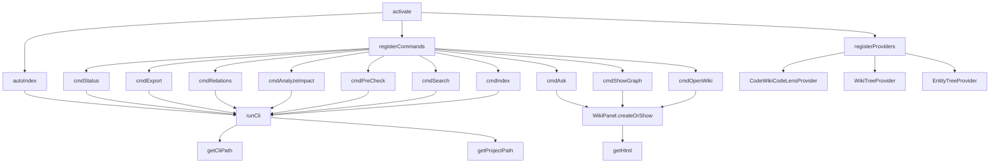

# Vscode Extension/src

**Relevant source files**

- [vscode-extension/src/extension.ts](vscode-extension/src/extension.ts)

## Purpose and Scope

This page documents the `Vscode Extension/src` module, which is the core activation and command-handling layer of the CodeWiki VS Code extension. It defines the extension's lifecycle (`activate`, `deactivate`), provides utility functions for CLI interaction and project path resolution, registers all VS Code commands (indexing, search, analysis, graph visualization, etc.), and implements custom UI providers (CodeLens, TreeView, WebView panels). The module serves as the single entry point for all extension functionality, bridging the VS Code API with the underlying CLI tool.

## Related Pages

- [CLI Integration](./cli-integration.md) – Details on `runCli` and `runCliJson` functions
- [Tree View Providers](./tree-providers.md) – WikiTreeProvider and EntityTreeProvider implementation
- [WebView Panels](./webview-panels.md) – WikiPanel and HTML rendering
- [Command Reference](./commands.md) – All registered VS Code commands

## Component Interaction

## Key Classes and Functions

| Name | File:Line | Purpose |
|------|-----------|---------|
| `activate` | [extension.ts#L24-L72](vscode-extension/src/extension.ts#L24-L72) | Extension entry point; registers all commands, providers, and triggers auto-indexing |
| `deactivate` | [extension.ts#L73-L79](vscode-extension/src/extension.ts#L73-L79) | Cleanup on extension deactivation |
| `getProjectPath` | [extension.ts#L80-L84](vscode-extension/src/extension.ts#L80-L84) | Resolves the workspace root folder path |
| `getCliPath` | [extension.ts#L85-L89](vscode-extension/src/extension.ts#L85-L89) | Locates the CodeWiki CLI binary in the extension bundle |
| `runCli` | [extension.ts#L90-L108](vscode-extension/src/extension.ts#L90-L108) | Executes CLI commands with arguments and returns stdout |
| `runCliJson` | [extension.ts#L109-L120](vscode-extension/src/extension.ts#L109-L120) | Wraps `runCli` and parses JSON output |
| `autoIndex` | [extension.ts#L121-L133](vscode-extension/src/extension.ts#L121-L133) | Automatically indexes the project on activation if no index exists |
| `cmdIndex` | [extension.ts#L134-L150](vscode-extension/src/extension.ts#L134-L150) | Command handler for manual indexing |
| `cmdSearch` | [extension.ts#L151-L188](vscode-extension/src/extension.ts#L151-L188) | Searches the wiki index and shows results in a QuickPick |
| `cmdPreCheck` | [extension.ts#L189-L242](vscode-extension/src/extension.ts#L189-L242) | Validates project structure and CLI availability |
| `cmdAnalyzeImpact` | [extension.ts#L243-L267](vscode-extension/src/extension.ts#L243-L267) | Analyzes impact of changes on the codebase |
| `cmdRelations` | [extension.ts#L268-L294](vscode-extension/src/extension.ts#L268-L294) | Shows entity relations in a tree view |
| `cmdOpenWiki` | [extension.ts#L295-L298](vscode-extension/src/extension.ts#L295-L298) | Opens the wiki panel |
| `cmdShowGraph` | [extension.ts#L299-L304](vscode-extension/src/extension.ts#L299-L304) | Shows the dependency graph |
| `cmdAsk` | [extension.ts#L305-L327](vscode-extension/src/extension.ts#L305-L327) | AI-powered question answering about the codebase |
| `cmdExport` | [extension.ts#L328-L341](vscode-extension/src/extension.ts#L328-L341) | Exports wiki data to various formats |
| `cmdStatus` | [extension.ts#L342-L356](vscode-extension/src/extension.ts#L342-L356) | Shows current indexing status |
| `CodeWikiCodeLensProvider` | [extension.ts#L357-L388](vscode-extension/src/extension.ts#L357-L388) | Provides CodeLens actions for wiki entities |
| `WikiTreeProvider` | [extension.ts#L389-L400](vscode-extension/src/extension.ts#L389-L400) | Tree view provider for wiki structure |
| `EntityTreeProvider` | [extension.ts#L401-L417](vscode-extension/src/extension.ts#L401-L417) | Tree view provider for entity relationships |
| `WikiPanel` | [extension.ts#L418-L434](vscode-extension/src/extension.ts#L418-L434) | WebView panel for wiki content |
| `WikiPanel.createOrShow` | [extension.ts#L422-L434](vscode-extension/src/extension.ts#L422-L434) | Creates or reveals the wiki panel |
| `WikiPanel.getHtml` | [extension.ts#L435-L450](vscode-extension/src/extension.ts#L435-L450) | Generates HTML content for the wiki panel |

## Implementation Details

### Activation and Command Registration

The `activate` function [extension.ts#L24-L72](vscode-extension/src/extension.ts#L24-L72) is the extension's entry point. It:
1. Retrieves the VS Code extension context
2. Calls `getProjectPath()` to determine the workspace root
3. Calls `getCliPath()` to locate the CLI binary
4. Registers all commands using `vscode.commands.registerCommand`
5. Registers providers (CodeLens, TreeView) via `vscode.languages.registerCodeLensProvider` and `vscode.window.registerTreeDataProvider`
6. Triggers `autoIndex()` if no existing index is found

### CLI Interaction

The `runCli` function [extension.ts#L90-L108](vscode-extension/src/extension.ts#L90-L108) handles all CLI execution:
- Constructs the command with the CLI path and arguments
- Uses `child_process.execFile` for execution
- Returns stdout as a string
- `runCliJson` [extension.ts#L109-L120](vscode-extension/src/extension.ts#L109-L120) wraps this with JSON parsing

### Command Handlers

Each command handler follows a consistent pattern:
1. Validate prerequisites (project open, CLI available)
2. Call `runCli` or `runCliJson` with appropriate arguments
3. Process results and display to user via VS Code UI APIs (QuickPick, OutputChannel, WebView)

For example, `cmdSearch` [extension.ts#L151-L188](vscode-extension/src/extension.ts#L151-L188):
- Calls `runCliJson(['search', query])`
- Parses results into QuickPick items
- Shows QuickPick and handles selection

### UI Providers

- **CodeWikiCodeLensProvider** [extension.ts#L357-L388](vscode-extension/src/extension.ts#L357-L388): Implements `provideCodeLenses` to show inline actions for wiki entities
- **WikiTreeProvider** [extension.ts#L389-L400](vscode-extension/src/extension.ts#L389-L400): Implements `getChildren` to display wiki structure
- **EntityTreeProvider** [extension.ts#L401-L417](vscode-extension/src/extension.ts#L401-L417): Implements `getChildren` to show entity relationships

### WikiPanel

The `WikiPanel` class [extension.ts#L418-L434](vscode-extension/src/extension.ts#L418-L434) manages a WebView panel:
- `createOrShow` [extension.ts#L422-L434](vscode-extension/src/extension.ts#L422-L434): Creates or reveals the panel, sets its HTML content
- `getHtml` [extension.ts#L435-L450](vscode-extension/src/extension.ts#L435-L450): Generates HTML with embedded CSS/JS for wiki rendering

## Integration Points

1. **VS Code API**: The module integrates with:
   - `vscode.commands` for command registration
   - `vscode.languages` for CodeLens providers
   - `vscode.window` for TreeView, QuickPick, OutputChannel, WebViewPanel
   - `vscode.workspace` for workspace folder access

2. **CLI Binary**: All data operations flow through `runCli`/`runCliJson` which invoke the external CodeWiki CLI tool

3. **Extension Context**: The `activate` function receives `vscode.ExtensionContext` for managing subscriptions and state

4. **WebView Communication**: `WikiPanel` uses `postMessage` and `onDidReceiveMessage` for bidirectional communication with the webview content

Sources:
- [vscode-extension/src/extension.ts#L24-L72](vscode-extension/src/extension.ts#L24-L72)
- [vscode-extension/src/extension.ts#L80-L120](vscode-extension/src/extension.ts#L80-L120)
- [vscode-extension/src/extension.ts#L134-L356](vscode-extension/src/extension.ts#L134-L356)
- [vscode-extension/src/extension.ts#L357-L450](vscode-extension/src/extension.ts#L357-L450)
