# API Reference

**Relevant source files**

- [cli/codewiki-cli.ts](cli/codewiki-cli.ts)
- [dist-electron/main.js](dist-electron/main.js)
- [electron/main.ts](electron/main.ts)
- [server/mcp-server.ts](server/mcp-server.ts)
- [src/App.tsx](src/App.tsx)
- [src/components/ChatPanel.tsx](src/components/ChatPanel.tsx)
- [src/components/CodeAgentPanel.tsx](src/components/CodeAgentPanel.tsx)
- [src/components/EntityDetailPanel.tsx](src/components/EntityDetailPanel.tsx)
- [src/components/KnowledgeGraph.tsx](src/components/KnowledgeGraph.tsx)
- [src/components/Layout.tsx](src/components/Layout.tsx)
- [src/components/MermaidDiagram.tsx](src/components/MermaidDiagram.tsx)
- [src/components/SearchPanel.tsx](src/components/SearchPanel.tsx)

## Purpose and Scope

This page provides a comprehensive API reference for the CodeWiki codebase, covering all exported classes, interfaces, functions, and methods across the CLI, Electron, server, and React components. It serves as the authoritative source for developers integrating with or extending the CodeWiki system, detailing type signatures, file locations, and functional purposes.

## Related Pages

- [Architecture Overview](architecture-overview.md)
- [CLI Command Reference](cli-commands.md)
- [Data Model Documentation](data-model.md)
- [Component Library](component-library.md)
- [Server API](server-api.md)

## Class Hierarchy

```mermaid
classDiagram
    class Compatibility {
        +cli/codewiki-cli.ts:818
    }
    class Diagrams {
        +cli/codewiki-cli.ts:2707
        +cli/codewiki-cli.ts:2715
        +cli/codewiki-cli.ts:2723
    }
    class FileNode {
        +Interface
        +cli/codewiki-cli.ts:30
        +electron/main.ts:168
        +server/mcp-server.ts:82
    }
    class OntologyEntity {
        +Interface
        +cli/codewiki-cli.ts:39
        +server/mcp-server.ts:91
    }
    class OntologyRelation {
        +Interface
        +cli/codewiki-cli.ts:49
        +server/mcp-server.ts:101
    }
    class OntologyGraph {
        +Interface
        +cli/codewiki-cli.ts:57
        +server/mcp-server.ts:108
    }
    class CacheData {
        +Interface
        +cli/codewiki-cli.ts:62
    }
    class Doc {
        +Interface
        +cli/codewiki-cli.ts:413
        +server/mcp-server.ts:208
    }
    class CLIConfig {
        +Interface
        +cli/codewiki-cli.ts:1142
    }
    class ScipOccurrence {
        +Interface
        +cli/codewiki-cli.ts:1819
    }
    class ScipDocument {
        +Interface
        +cli/codewiki-cli.ts:1825
    }
    class WikiCheckRule {
        +Interface
        +cli/codewiki-cli.ts:2479
    }
    class CliWikiTemplate {
        +Interface
        +cli/codewiki-cli.ts:2673
    }
    class CallLogEntry {
        +Interface
        +cli/codewiki-cli.ts:3337
    }
    class TestCase {
        +Interface
        +cli/codewiki-cli.ts:4172
    }
    class TestSuite {
        +Interface
        +cli/codewiki-cli.ts:4206
    }
    class TestResult {
        +Interface
        +cli/codewiki-cli.ts:4212
    }
    class McpCallLogEntry {
        +Interface
        +server/mcp-server.ts:34
    }
    class FileHash {
        +Interface
        +server/mcp-server.ts:256
    }
    class AgentResult {
        +Interface
        +src/components/CodeAgentPanel.tsx:10
    }
    class Props {
        +Interface
        +src/components/MermaidDiagram.tsx:23
        +src/components/SettingsModal.tsx:11
    }
    Compatibility --> Diagrams : uses
    OntologyGraph --> OntologyEntity : contains
    OntologyGraph --> OntologyRelation : contains
    Doc --> FileNode : references
    TestSuite --> TestCase : contains
    TestResult --> TestCase : evaluates
```

## API Summary Tables

### Interfaces

| Name | File:Line | Description |
|------|-----------|-------------|
| `FileNode` | [cli/codewiki-cli.ts:30](cli/codewiki-cli.ts#L30), [electron/main.ts:168](electron/main.ts#L168), [server/mcp-server.ts:82](server/mcp-server.ts#L82) | Represents a file node in the project tree with path, type, and children |
| `OntologyEntity` | [cli/codewiki-cli.ts:39](cli/codewiki-cli.ts#L39), [server/mcp-server.ts:91](server/mcp-server.ts#L91) | Defines an entity in the code ontology with name, type, and metadata |
| `OntologyRelation` | [cli/codewiki-cli.ts:49](cli/codewiki-cli.ts#L49), [server/mcp-server.ts:101](server/mcp-server.ts#L101) | Defines a relationship between two ontology entities |
| `OntologyGraph` | [cli/codewiki-cli.ts:57](cli/codewiki-cli.ts#L57), [server/mcp-server.ts:108](server/mcp-server.ts#L108) | Container for ontology entities and relations |
| `CacheData` | [cli/codewiki-cli.ts:62](cli/codewiki-cli.ts#L62) | Structure for cached analysis data |
| `Doc` | [cli/codewiki-cli.ts:413](cli/codewiki-cli.ts#L413), [server/mcp-server.ts:208](server/mcp-server.ts#L208) | Represents a documentation entry with content and metadata |
| `CLIConfig` | [cli/codewiki-cli.ts:1142](cli/codewiki-cli.ts#L1142) | Configuration interface for CLI operations |
| `ScipOccurrence` | [cli/codewiki-cli.ts:1819](cli/codewiki-cli.ts#L1819) | SCIP protocol occurrence data structure |
| `ScipDocument` | [cli/codewiki-cli.ts:1825](cli/codewiki-cli.ts#L1825) | SCIP protocol document data structure |
| `WikiCheckRule` | [cli/codewiki-cli.ts:2479](cli/codewiki-cli.ts#L2479) | Rule definition for wiki content validation |
| `CliWikiTemplate` | [cli/codewiki-cli.ts:2673](cli/codewiki-cli.ts#L2673) | Template structure for CLI wiki generation |
| `CallLogEntry` | [cli/codewiki-cli.ts:3337](cli/codewiki-cli.ts#L3337) | Entry in the function call log |
| `TestCase` | [cli/codewiki-cli.ts:4172](cli/codewiki-cli.ts#L4172) | Test case definition with inputs and expected outputs |
| `TestSuite` | [cli/codewiki-cli.ts:4206](cli/codewiki-cli.ts#L4206) | Collection of test cases |
| `TestResult` | [cli/codewiki-cli.ts:4212](cli/codewiki-cli.ts#L4212) | Result of test execution |
| `McpCallLogEntry` | [server/mcp-server.ts:34](server/mcp-server.ts#L34) | MCP server call log entry |
| `FileHash` | [server/mcp-server.ts:256](server/mcp-server.ts#L256) | File hash tracking structure |
| `AgentResult` | [src/components/CodeAgentPanel.tsx:10](src/components/CodeAgentPanel.tsx#L10) | Result from code agent execution |
| `Props` | [src/components/MermaidDiagram.tsx:23](src/components/MermaidDiagram.tsx#L23), [src/components/SettingsModal.tsx:11](src/components/SettingsModal.tsx#L11) | React component props interface |

### Classes

| Name | File:Line | Description |
|------|-----------|-------------|
| `Compatibility` | [cli/codewiki-cli.ts:818](cli/codewiki-cli.ts#L818) | Handles backward compatibility checks and migrations |
| `Diagrams` | [cli/codewiki-cli.ts:2707](cli/codewiki-cli.ts#L2707) | Diagram generation engine (multiple overloads at lines 2715, 2723) |

### Functions and Methods

| Name | File:Line | Description |
|------|-----------|-------------|
| `isPythonFile` | [cli/codewiki-cli.ts:92](cli/codewiki-cli.ts#L92) | Checks if a file path has a Python extension |
| `findPythonBlockEnd` | [cli/codewiki-cli.ts:96](cli/codewiki-cli.ts#L96) | Locates the end of a Python code block |
| `readDirectoryRecursive` | [cli/codewiki-cli.ts:112](cli/codewiki-cli.ts#L112) | Recursively reads directory structure |
| `flattenFiles` | [cli/codewiki-cli.ts:142](cli/codewiki-cli.ts#L142) | Flattens nested file tree into flat list |
| `uid` | [cli/codewiki-cli.ts:151](cli/codewiki-cli.ts#L151) | Generates unique identifiers |
| `buildOntology` | [cli/codewiki-cli.ts:153](cli/codewiki-cli.ts#L153) | Builds ontology graph from codebase |
| `resolveImport` | [cli/codewiki-cli.ts:296](cli/codewiki-cli.ts#L296) | Resolves import paths to actual files |
| `findBlockEnd` | [cli/codewiki-cli.ts:383](cli/codewiki-cli.ts#L383) | Finds end of code block in source |
| `buildSearchDocs` | [cli/codewiki-cli.ts:415](cli/codewiki-cli.ts#L415) | Builds searchable document index |
| `tfidfSearch` | [cli/codewiki-cli.ts:421](cli/codewiki-cli.ts#L421) | Performs TF-IDF based search |
| `getImpactedEntities` | [cli/codewiki-cli.ts:447](cli/codewiki-cli.ts#L447) | Identifies entities impacted by changes |
| `getCachePath` | [cli/codewiki-cli.ts:465](cli/codewiki-cli.ts#L465) | Gets cache file path |
| `saveCache` | [cli/codewiki-cli.ts:469](cli/codewiki-cli.ts#L469) | Saves data to cache |
| `loadCache` | [cli/codewiki-cli.ts:477](cli/codewiki-cli.ts#L477) | Loads data from cache |
| `output` | [cli/codewiki-cli.ts:492](cli/codewiki-cli.ts#L492) | Generic output handler |
| `printHuman` | [cli/codewiki-cli.ts:501](cli/codewiki-cli.ts#L501) | Human-readable output formatter |
| `cmdIndex` | [cli/codewiki-cli.ts:539](cli/codewiki-cli.ts#L539) | Index command handler |
| `addConfidenceScores` | [cli/codewiki-cli.ts:556](cli/codewiki-cli.ts#L556) | Adds confidence scores to search results |
| `getGraph` | [cli/codewiki-cli.ts:570](cli/codewiki-cli.ts#L570) | Retrieves dependency graph |
| `cmdAnalyze` | [cli/codewiki-cli.ts:591](cli/codewiki-cli.ts#L591) | Analyze command handler |
| `cmdSearch` | [cli/codewiki-cli.ts:635](cli/codewiki-cli.ts#L635) | Search command handler |
| `cmdEntity` | [cli/codewiki-cli.ts:643](cli/codewiki-cli.ts#L643) | Entity command handler |
| `cmdImpact` | [cli/codewiki-cli.ts:662](cli/codewiki-cli.ts#L662) | Impact analysis command handler |
| `cmdDeps` | [cli/codewiki-cli.ts:685](cli/codewiki-cli.ts#L685) | Dependencies command handler |
| `traverse` | [cli/codewiki-cli.ts:693](cli/codewiki-cli.ts#L693) | Tree traversal utility |
| `cmdValidate` | [cli/codewiki-cli.ts:716](cli/codewiki-cli.ts#L716) | Validate command handler |
| `cmdPreCheck` | [cli/codewiki-cli.ts:759](cli/codewiki-cli.ts#L759) | Pre-check command handler |
| `cmdVerify` | [cli/codewiki-cli.ts:852](cli/codewiki-cli.ts#L852) | Verify command handler |
| `cmdApply` | [cli/codewiki-cli.ts:950](cli/codewiki-cli.ts#L950) | Apply command handler |
| `cmdApplyJson` | [cli/codewiki-cli.ts:990](cli/codewiki-cli.ts#L990) | Apply JSON command handler |
| `cmdRollback` | [cli/codewiki-cli.ts:1020](cli/codewiki-cli.ts#L1020) | Rollback command handler |
| `cmdDiff` | [cli/codewiki-cli.ts:1053](cli/codewiki-cli.ts#L1053) | Diff command handler |
| `cmdStatus` | [cli/codewiki-cli.ts:1103](cli/codewiki-cli.ts#L1103) | Status command handler |
| `getConfigPath` | [cli/codewiki-cli.ts:1149](cli/codewiki-cli.ts#L1149) | Gets configuration file path |
| `loadCLIConfig` | [cli/codewiki-cli.ts:1153](cli/codewiki-cli.ts#L1153) | Loads CLI configuration |
| `cmdConfig` | [cli/codewiki-cli.ts:1159](cli/codewiki-cli.ts#L1159) | Config command handler |
| `cmdRelations` | [cli/codewiki-cli.ts:1212](cli/codewiki-cli.ts#L1212) | Relations command handler |
| `findEntity` | [cli/codewiki-cli.ts:1248](cli/codewiki-cli.ts#L1248) | Finds entity by name |
| `cmdCallers` | [cli/codewiki-cli.ts:1255](cli/codewiki-cli.ts#L1255) | Callers command handler |
| `cmdCallees` | [cli/codewiki-cli.ts:1288](cli/codewiki-cli.ts#L1288) | Callees command handler |

## Sources:

- [cli/codewiki-cli.ts](cli/codewiki-cli.ts) (lines 30-1288, 1819-1825, 2479-2723, 3337, 4172-4212)
- [electron/main.ts](electron/main.ts) (line 168)
- [server/mcp-server.ts](server/mcp-server.ts) (lines 34-256)
- [src/components/CodeAgentPanel.tsx](src/components/CodeAgentPanel.tsx) (line 10)
- [src/components/MermaidDiagram.tsx](src/components/MermaidDiagram.tsx) (line 23)
- [src/components/SettingsModal.tsx](src/components/SettingsModal.tsx) (line 11)
